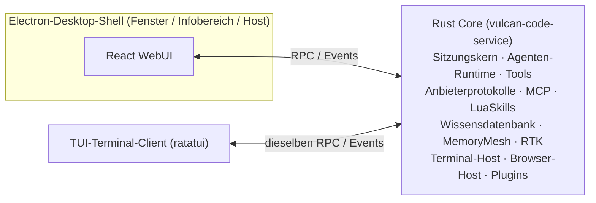

<div align="center">


# Vulcan Code

**Eine quelloffene AI-Coding-Werkbank: GUI-Desktop-App + Terminal-TUI**

Rust Core · Electron-Desktop-Shell · React WebUI · ratatui TUI

[](LICENSE)
[](https://github.com/OpenVulcan/vulcan-code/issues)
[](https://github.com/OpenVulcan/vulcan-code/pulls)

[简体中文](README.md) | [English](README.en.md) | [繁體中文](README.zh-TW.md) | [日本語](README.ja.md) | [한국어](README.ko.md) | [Español](README.es.md) | [Français](README.fr.md) | **Deutsch** | [Русский](README.ru.md) | [Português](README.pt-BR.md)

</div>

> Dies ist eine Übersetzung der [README in vereinfachtem Chinesisch](README.md). Bei Abweichungen ist die chinesische Fassung maßgeblich. Übersetzungskorrekturen sind per PR willkommen.

---

## Über das Projekt

Vulcan Code ist eine **AI-Coding-Anwendung** mit zwei Clients: einer GUI-Desktop-App und einer Terminal-TUI. Sie vereint Projekte, Sitzungen, Terminals, einen Browser, Code-Review und Git-Commits in einer einzigen Werkbank, damit die KI Ihren Code versteht, Aufgaben voranbringt und überprüfbare Ergebnisse liefert.

Das Projekt wurde lange intern entwickelt und getestet und ist jetzt unter der **MIT-Lizenz** quelloffen. Es soll mehr sein als das Produkt eines einzelnen Teams – ein Werkzeug, das die Community gemeinsam weiterentwickelt:

- 🐛 Ein Problem gefunden oder eine Idee? Eröffnen Sie ein [Issue](https://github.com/OpenVulcan/vulcan-code/issues)
- 🔧 Einen Bug behoben oder ein Feature gebaut? Senden Sie einen [Pull Request](https://github.com/OpenVulcan/vulcan-code/pulls)
- 🤝 Nutzer wie Entwickler sind eingeladen mitzumachen – bauen wir gemeinsam eine AI-Coding-Software, die alle gerne nutzen

## Highlights

### 🧭 Desktop-Werkbank

- Verwaltung mehrerer Projekte und Sitzungen, frei kombinierbare Panels für Dateien, Review, Gedächtnis und Sub-Agenten
- Integriertes Projekt-Terminal mit Tabs; die KI kann lang laufende oder interaktive Befehlssitzungen halten
- Streaming-Antworten mit direkt gerendertem Markdown, Codeblöcken, Mermaid/SVG-Diagrammen und Tool-Aufruf-Karten
- Frühere Eingaben bearbeiten und neu generieren oder von jedem abgeschlossenen Turn eine neue Sitzung abzweigen
- Chinesische und englische Oberfläche, helles und dunkles Theme

### 💻 Terminal-Client (TUI)

- Dieselbe Werkbank im Terminal: Projekte und Sitzungen, Konversation und Denkprozess, Tool-Aufrufe, Rückfragen, Git-Änderungen und -Commits sowie Gedächtnis, Wissensdatenbank, Skills, Agenten, Plugin-Verwaltung und Systemeinstellungen
- Nutzt dieselbe Dienstschnittstelle wie das WebUI und verbindet sich mit demselben Core
- Volle Mausunterstützung: Klick, Doppelklick, Kontextmenü und Mausrad; Befehlspalette, Slash-Befehle und Tastenkürzel
- Direkt über das Menü im Infobereich öffnen oder mit `make bt` bauen und starten; siehe [TUI-Anleitung](apps/vulcan-code-tui/README.md)

### 🎯 Aufgaben voranbringen

- **Goal-Modus**: Ziel und Token-Budget festlegen; die KI arbeitet Turn für Turn weiter, Pausieren, Fortsetzen und Löschen sind möglich
- **Plan-Modus**: erst erkunden und einen Plan erstellen, nach Ihrer Bestätigung ausführen
- **Steuerung während der Ausführung**: Anweisungen ergänzen oder Folgeanfragen einreihen, während eine Aufgabe läuft
- **Sub-Agenten**: integrierte Rollen wie Explore und Plan sowie über 260 Rollenvorlagen aus [agency-agents](https://github.com/msitarzewski/agency-agents) (standardmäßig deaktiviert, bei Bedarf aktivierbar)
- **Strukturierte Rückfragen**: Braucht die KI eine Entscheidung von Ihnen, fragt sie mit Optionskarten nach

### 🧠 Code verstehen und Erfahrung aufbauen

- **CodeKit – Code-Navigation**: Strukturortung, Textsuche, Extraktion von Funktionsrümpfen und Ersetzen ganzer Funktionen direkt auf dem aktuellen Arbeitsbaum; es gibt keinen vorab erstellten Index, also veraltet nichts. Für semantische Codesuche lässt sich ein externer MCP-Dienst anbinden
- **KI-verwaltete Wissensdatenbank**: Die KI organisiert, liest und durchsucht langfristige Unterlagen mit eigenen Tools, mit BM25-, Vektor- und Hybridsuche; der Verlauf bleibt dauerhaft erhalten und lässt sich wiederherstellen; Freigabe pro Projekt, Auswahl pro Sitzung
- **MemoryMesh – Langzeitgedächtnis**: destilliert nach jedem Turn Erfahrungen und ruft sie vor dem nächsten ab; Erinnerungen lassen sich einsehen, korrigieren und löschen, mit Papierkorb und Herkunftsnachweis

### 🔍 Überprüfbare Ergebnisse

- **Diff-Review**: vereinheitlichte/geteilte Ansicht, Unterschiede auf Wortebene, Volltextsuche, Stagen und Zurücksetzen
- **Git-Commits**: KI-generierte Commit-Nachrichten, Commit auf den aktuellen oder einen neuen Branch und direkter Push
- **KI-Browser**: Die KI navigiert, klickt, erstellt Screenshots und liest die Konsole in einer echten Chromium-Seite; Sie können jederzeit die Kontrolle übernehmen

### 🧩 Erweiterbar

- **Prompt-Skills** (`SKILL.md`): die Arbeitsweise Ihres Teams festhalten und beim nächsten Mal wiederverwenden
- **LuaSkills**: häufige Abläufe als konfigurierbare, installierbare programmatische Fähigkeitspakete bündeln
- **MCP**: MCP-Server als lokaler Prozess oder über HTTP, mit Verbindungsdiagnose und Einsicht in Tool-Schemas
- **MCP-Dienst**: Vulcan ist auch selbst ein MCP-Server. Andere KI-Werkzeuge wie Claude Code und Codex können je nach Freigabe Projekte und Sitzungen auflisten, Nachrichten senden und auf die Antwort warten, Sitzungen starten, Läufe stoppen und Fragen beantworten sowie gesondert freigegebene Bild- und Videomodelle aufrufen; jedes Werkzeug erhält ein eigenes Token, und Berechtigungsfreigaben bleiben immer in Vulcan
- **Plugin-System**: Plugins können Tools bereitstellen und eigene Oberflächen einbinden. Integrierte Plugins: Context7-Dokumentationssuche, KI-Browser, Nutzungsstatistik, CDP/DAP-Debugging-Tools

### ⚙️ Modelle und Anbieter

- Unterstützt die Protokollfamilien OpenAI, Anthropic, Gemini und Cohere, mit integrierten Konfigurationen für OpenAI, Anthropic, Google, DeepSeek, Kimi, MiniMax, Alibaba, OpenRouter u. a.; eigene Anbieter können hinzugefügt werden
- Chat, Gedächtnisabruf, Vektoren der Wissensdatenbank und Mediengenerierung können jeweils ein eigenes Modell nutzen
- Erweiterte Fähigkeiten: Websuche und Abruf von Webseiten; Bild-, Video- und Audioverständnis; Bild- und Videogenerierung; Sprachsynthese und Transkription
- Mehrstufige Richtlinien für das Kontextfenster, mit automatischer oder manueller (`/compact`) Kontextkomprimierung
- **RTK – Komprimierung der Befehlsausgabe**: RTK ist nativ in den Host integriert und komprimiert Befehlsausgaben und den Kontext von Git-Commits, um Tokens zu sparen; in den Einstellungen ein- und ausschaltbar, mit Statistik der Einsparungen
- Statistiken zu Token-Verbrauch, Latenz und Referenzkosten

## Roadmap

Verfügbar sind heute die **GUI-Desktop-App** und die **Terminal-TUI**. Als Nächstes geplant:

- [ ] **Remote-Verbindung per Smartphone**: auf dem Desktop laufende Sitzungen vom Handy aus einsehen und steuern
- [ ] **Validierung unter Linux / macOS**: Build-Skripte sind vorhanden, eine vollständige Validierung auf jeder Plattform steht noch aus

Wenn Sie einer dieser Punkte interessiert oder Sie neue Ideen haben, diskutieren wir gerne in den Issues.

## Architektur



Der Core-Dienst kann eigenständig im Hintergrund (Infobereich) laufen; weder das Schließen des Desktop-Fensters noch das Beenden der TUI unterbricht laufende Aufgaben. Die Desktop-App, das WebUI im Browser und die TUI verbinden sich mit demselben Core.

| Verzeichnis | Beschreibung |
| --- | --- |
| `apps/vulcan-code-service` | Host des Core-Dienstes: Sitzungskern, Agenten-Runtime und RPC/Streaming-Dienste für das WebUI |
| `apps/vulcan-code-desktop` | Electron-Desktop-Shell: Fenster und Infobereich; startet den lokalen Core und lädt das WebUI |
| `apps/vulcan-code-web` | React/Vite-WebUI: Werkbank, Einstellungen, Sitzungen, Diff, Skills u. v. m. |
| `apps/vulcan-code-tui` | TUI-Terminal-Client (ratatui): ruft dieselbe Dienstschnittstelle mit den Funktionen und Parametern des WebUI auf |
| `crates/vulcan-agent-runtime` | Gemeinsame Agenten-Runtime: Anbieter, Tools, LuaSkills, MCP, Streaming-Ausführung |
| `crates/vulcan-service-*` | Backend-Dienst-API, Kern des Core-Dienstes und Runtime-Adapter |
| `crates/vulcan-memorymesh-*` | MemoryMesh-Langzeitgedächtnis |
| `crates/vulcan-runtime-assets` | Maßgebliche Ressourcen: System-Prompts, Anbieter-Manifeste, Sub-Agenten-Vorlagen |
| `plugins/` | Integrierte Plugins |
| `docs/contracts/` | Entwicklungsverträge (Contract-Dokumente) |

## Erste Schritte

> Vollständig validiert ist derzeit **Windows x86_64**. Für Linux und macOS gibt es das passende Skript `make.sh`, ein vollständiger Durchlauf steht jedoch noch aus – Hilfe bei der Validierung ist willkommen.

### Voraussetzungen

- `make`
- [Rustup](https://rustup.rs/): Die Toolchain-Version ist in `rust-toolchain.toml` festgelegt und wird automatisch installiert
- PowerShell 7
- Node.js und pnpm

### Bauen und starten

```bash
make init-system   # Beim ersten Mal: Rust-Tools, Host-Abhängigkeiten und verwaltetes Node/pnpm installieren
make sync          # Konfiguration, System-Skills, Plugins und Browser-Runtime nach output/ synchronisieren
make build         # Core, WebUI und Electron-Desktop-Shell bauen
make run           # Desktop-App starten
```

Mit `make br` lässt sich in einem Schritt bauen und starten; `make bt` baut vollständig, startet den Core und öffnet die TUI, ohne Desktop-App und Vite. Für Release-Builds verwenden Sie `make release`.

Details zur Umgebung finden Sie in [`docs/contracts/development-environment.md`](docs/contracts/development-environment.md).

### Entwicklungsalltag

Vite-Entwicklungsserver, Core-Dienst und Electron-Shell sind voneinander unabhängig und lassen sich getrennt starten und neu starten:

```bash
make vite start      # Vite-Entwicklungsserver des WebUI starten (auch status / stop)
make service         # Nur den Core im Hintergrund starten, ohne Desktop-Fenster
make core-restart    # Nur Änderungen am Rust-Core: inkrementeller Build und Hot-Swap des Core (Windows Debug)
make sync            # Nach Änderungen an Ressourcen, Konfiguration, Skills oder Plugins erneut synchronisieren
```

- Bei reinen WebUI-Änderungen Vite und die Desktop-Shell laufen lassen, dann greift Hot Reload
- Im Debug-Modus stellen `make run` / `make br` sicher, dass Vite läuft
- `output/` nicht direkt bearbeiten; die maßgeblichen Ressourcen liegen in `crates/vulcan-runtime-assets/resources/`

## Mitwirken

Beiträge jeder Art sind willkommen: Fehlerberichte, Dokumentation, UX-Verbesserungen, neue Plattformen, neue Anbieter, Plugins und Skills …

**Ein Issue eröffnen**

- Bugs: Bitte Betriebssystem, Schritte zur Reproduktion, erwartetes und tatsächliches Verhalten sowie relevante Logs oder Screenshots angeben
- Feature-Wünsche: Anwendungsfall und das zu lösende Problem beschreiben

**Einen PR einreichen**

1. Repository forken und einen Branch von `main` erstellen
2. Vor Änderungen [`AGENTS.md`](AGENTS.md) lesen. Dort sind die dauerhaften Konventionen des Repositorys festgehalten; für bestimmte Bereiche zusätzlich die passenden Dokumente in [`docs/contracts/`](docs/contracts/) lesen
3. Vor dem Einreichen lokal prüfen:

   ```bash
   # Rust: bevorzugt gezielte Prüfungen der geänderten Crates
   cargo check -p <crate> --all-targets
   cargo nextest run -p <crate>

   # WebUI
   pnpm --dir apps/vulcan-code-web run lint
   pnpm --dir apps/vulcan-code-web run test
   pnpm --dir apps/vulcan-code-web run build
   ```

4. In der PR-Beschreibung erläutern, was geändert wurde, warum und wie es geprüft wurde

Einige Konventionen:

- An die KI gerichtete Tool-Namen, Beschreibungen und Schemas werden auf Englisch verfasst; Oberflächentexte für Nutzer werden lokalisiert
- Die Parallelität von Builds und Tests ist standardmäßig auf 4 begrenzt; bitte diese Grenze in Prüfbefehlen nicht entfernen
- Ein PR sollte möglichst nur ein Thema behandeln, um das Review zu erleichtern

## Danksagungen

Vulcan Code baut auf vielen hervorragenden Open-Source-Projekten auf. Danke an deren Autorinnen, Autoren und Communities.

**Integrierte Komponenten und Tools**

- [RTK](https://github.com/rtk-ai/rtk): Komprimierung der Befehlsausgabe zum Sparen von Tokens (nativ in den Host integriert)
- [Context7](https://github.com/upstash/context7): aktuelle, versionsbezogene Bibliotheksdokumentation (Plugin Context7)
- [Playwright](https://github.com/microsoft/playwright) / [Playwright MCP](https://github.com/microsoft/playwright-mcp): Treiber und Tools des KI-Browsers
- [LuaSkills](https://github.com/LuaSkills/luaskills): LuaSkills-Runtime
- [ripgrep](https://github.com/BurntSushi/ripgrep) und [ast-grep](https://github.com/ast-grep/ast-grep): mitgelieferte Werkzeuge für Text- und Syntaxbaumsuche

**Desktop und Oberfläche**

- [Electron](https://www.electronjs.org/): Desktop-Shell
- [React](https://react.dev/) und [Vite](https://vite.dev/): WebUI-Framework und Build-Tool
- [shadcn/ui](https://ui.shadcn.com/), [Radix UI](https://www.radix-ui.com/), [Tailwind CSS](https://tailwindcss.com/): Komponenten und Styling
- [xterm.js](https://xtermjs.org/): Terminal-Rendering
- [Shiki](https://shiki.style/): Syntaxhervorhebung für Code und Diffs
- [Mermaid](https://mermaid.js.org/): Diagramm-Rendering
- [Lucide](https://lucide.dev/), [Iconify](https://iconify.design/): Icons

**Terminal-Client**

- [Ratatui](https://ratatui.rs/): TUI-Rendering-Framework

**Rust Core**

- [Tokio](https://tokio.rs/) und [Axum](https://github.com/tokio-rs/axum): asynchrone Runtime und Service-Framework
- [rmcp](https://github.com/modelcontextprotocol/rust-sdk): offizielles MCP-SDK für Rust
- [LanceDB](https://github.com/lancedb/lancedb) und [Apache Arrow](https://arrow.apache.org/): Vektorindex und spaltenorientierte Daten
- [SQLite](https://sqlite.org/) ([rusqlite](https://github.com/rusqlite/rusqlite)): lokale Datenspeicherung
- [jieba-rs](https://github.com/messense/jieba-rs): chinesische Wortsegmentierung für die Volltextsuche der Wissensdatenbank
- [portable-pty](https://github.com/wezterm/wezterm) (WezTerm): plattformübergreifendes Pseudo-Terminal

**Referenzen für Design und Implementierung**

- [OpenAI Codex](https://github.com/openai/codex): Referenz für den Transport des Responses-Protokolls, Wiederholungsversuche und Kontextkomprimierung; Apply-Patch-Grammatik und Streaming-Parser sind aus Codex adaptiert
- [cc-switch](https://github.com/farion1231/cc-switch): Referenz für Multi-Protokoll-Konvertierung, Streaming-Tool-Aufrufe und Modellpreisdaten
- [CLIProxyAPI](https://github.com/router-for-me/CLIProxyAPI): Referenz für das Gemini-Protokoll und Kompatibilitätskonvertierung
- [OpenCode](https://github.com/anomalyco/opencode): Referenz für Anbieterkataloge und System-Prompts
- [agency-agents](https://github.com/msitarzewski/agency-agents): Quelle der Rollenvorlagen für Sub-Agenten
- [Answer me with HTML](https://github.com/QingYunA/answer-me-with-html): Designvorbild für HTML-Antworten, kompakte Inhaltsentwürfe und Vorlagenkomponenten; Protokoll, integrierter Renderer und isolierter Viewer sind eigenständig implementiert, ohne dessen CLI

**Community**

- [LINUX DO](https://linux.do/): Dank an die LINUX-DO-Community für Unterstützung und Austausch

Die vollständige Liste der Drittanbieter-Abhängigkeiten und ihrer Lizenzen steht in [`THIRD_PARTY_NOTICES.md`](crates/vulcan-runtime-assets/resources/licenses/THIRD_PARTY_NOTICES.md); in der App ist sie unter **Settings → About and licenses** einsehbar.

## Lizenz

[MIT](LICENSE) © 2026 OpenVulcan
