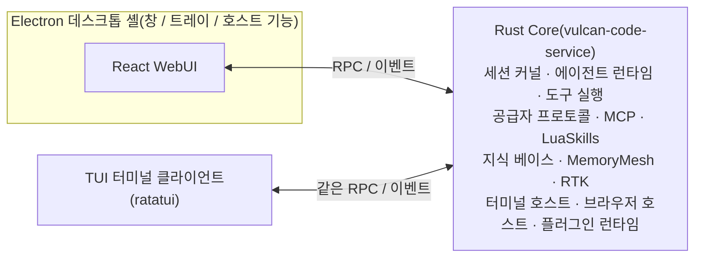

<div align="center">


# Vulcan Code

**오픈소스 AI Coding 워크벤치: GUI 데스크톱 앱 + 터미널 TUI**

Rust Core · Electron 데스크톱 셸 · React WebUI · ratatui TUI

[](LICENSE)
[](https://github.com/OpenVulcan/vulcan-code/issues)
[](https://github.com/OpenVulcan/vulcan-code/pulls)

[简体中文](README.md) | [English](README.en.md) | [繁體中文](README.zh-TW.md) | [日本語](README.ja.md) | **한국어** | [Español](README.es.md) | [Français](README.fr.md) | [Deutsch](README.de.md) | [Русский](README.ru.md) | [Português](README.pt-BR.md)

</div>

> 이 문서는 [중국어 간체 README](README.md)의 번역본입니다. 내용이 다를 경우 중국어판이 우선합니다. 번역 수정은 PR로 언제든 환영합니다.

---

## 프로젝트 소개

Vulcan Code는 **AI Coding 소프트웨어**로, GUI 데스크톱 앱과 터미널 TUI 두 가지 클라이언트를 제공합니다. 프로젝트, 세션, 터미널, 브라우저, 코드 리뷰, Git 커밋을 하나의 워크벤치에 모아, AI가 코드를 이해하고 작업을 진행하며 검토 가능한 결과물을 내놓을 수 있게 합니다.

이 프로젝트는 오랜 기간 내부에서 개발과 디버깅을 거쳤고, 이제 **MIT 라이선스**로 오픈소스화했습니다. 한 팀의 제품에 머무르지 않고 커뮤니티가 함께 다듬어 가는 도구가 되기를 바랍니다.

- 🐛 문제를 발견했거나 아이디어가 있다면 [Issue](https://github.com/OpenVulcan/vulcan-code/issues)를 남겨 주세요
- 🔧 버그를 고쳤거나 기능을 만들었다면 [Pull Request](https://github.com/OpenVulcan/vulcan-code/pulls)를 보내 주세요
- 🤝 사용자든 개발자든 누구나 참여할 수 있습니다. 모두가 사랑하는 AI Coding 소프트웨어를 함께 만들어요

## 주요 기능

### 🧭 데스크톱 워크벤치

- 여러 프로젝트와 세션을 관리하고, 파일 트리·리뷰·메모리·서브 에이전트 등 패널을 자유롭게 조합
- 탭을 지원하는 프로젝트 터미널 내장. AI가 장시간 실행되거나 상호작용이 필요한 명령 세션을 유지할 수 있음
- 스트리밍 응답. Markdown, 코드 블록, Mermaid/SVG 다이어그램, 도구 호출 카드를 바로 렌더링
- 이전 질문을 수정해 다시 생성하거나, 완료된 어느 턴에서든 새 세션으로 분기 가능
- 중국어·영어 UI, 라이트/다크 테마

### 💻 터미널 클라이언트(TUI)

- 같은 워크벤치를 터미널에서: 프로젝트와 세션, 대화와 사고 과정, 도구 호출, 질문, Git 변경과 커밋, 그리고 메모리, 지식 베이스, 스킬, 에이전트, 플러그인 관리, 시스템 설정
- WebUI와 같은 서비스 인터페이스를 사용하며 같은 Core에 연결
- 마우스 완전 지원: 클릭, 더블 클릭, 우클릭 메뉴, 휠 모두 사용 가능. 명령 팔레트, 슬래시 명령, 단축키 제공
- 트레이 메뉴에서 바로 열거나 `make bt`로 빌드 후 실행. 자세한 내용은 [TUI 안내](apps/vulcan-code-tui/README.md) 참고

### 🎯 작업 진행

- **Goal 모드**: 목표와 토큰 예산을 설정하면 AI가 턴 단위로 작업을 이어감. 일시정지·재개·해제 가능
- **Plan 모드**: 먼저 탐색하고 계획을 세운 뒤, 확인 후 실행
- **실행 중 지시**: 작업이 실행되는 동안 추가 지시를 보내거나 후속 요청을 대기열에 넣을 수 있음
- **서브 에이전트 협업**: Explore, Plan 등 내장 역할과 함께 [agency-agents](https://github.com/msitarzewski/agency-agents)의 260개 이상 역할 템플릿 포함(기본 비활성화, 필요 시 활성화)
- **구조화된 질문**: AI가 사용자의 결정이 필요할 때 선택지 카드로 질문

### 🧠 코드 이해와 경험 축적

- **CodeKit 코드 탐색**: 실시간 작업 트리에서 바로 구조 위치 찾기, 텍스트 검색, 함수 본문 추출, 함수 단위 교체를 수행. 인덱스를 미리 만들지 않으므로 인덱스가 오래될 일도 없음. 시맨틱 코드 검색이 필요하면 외부 MCP 서비스를 연결
- **AI 관리 지식 베이스**: AI가 전용 도구로 장기 자료를 정리·읽기·검색. BM25, 벡터, 하이브리드 검색 지원, 이력은 영구 보존되며 복원 가능. 프로젝트별 권한 부여, 세션별 선택 가능
- **MemoryMesh 장기 메모리**: 턴이 끝나면 경험을 추출하고 다음 턴 전에 자동으로 떠올림. 메모리는 조회·수정·삭제할 수 있으며 휴지통과 출처 추적 제공

### 🔍 검토 가능한 결과

- **Diff 리뷰**: 통합/분할 보기, 단어 단위 차이, 전문 검색, 스테이징과 되돌리기 지원
- **Git 커밋**: AI가 커밋 메시지를 생성하고, 현재 브랜치 또는 새 브랜치에 커밋한 뒤 바로 푸시
- **AI 브라우저**: AI가 실제 Chromium 페이지에서 이동, 클릭, 스크린샷, 콘솔 읽기를 수행. 언제든 제어권을 넘겨받을 수 있음

### 🧩 확장성

- **프롬프트 스킬**(`SKILL.md`): 팀의 작업 방식을 정리해 다음에 그대로 재사용
- **LuaSkills**: 자주 쓰는 동작을 설정·설치 가능한 프로그래밍형 기능 패키지로 묶음
- **MCP**: 로컬 프로세스와 HTTP 방식의 MCP 서버를 모두 지원하며 연결 진단과 도구 스키마 조회 제공
- **MCP 서비스**: Vulcan 자체도 MCP 서버입니다. Claude Code, Codex 등 다른 AI 도구가 권한에 따라 프로젝트와 세션 나열, 메시지 보내고 답장 기다리기, 세션 시작, 실행 중지, 질문 답변을 할 수 있고, 따로 허용한 이미지·동영상 모델도 호출할 수 있습니다. 도구마다 토큰을 하나씩 발급하며 권한 승인은 항상 Vulcan에 남습니다
- **플러그인 시스템**: 플러그인은 도구를 제공하고 자체 UI를 탑재할 수 있음. 내장 플러그인: Context7 문서 검색, AI 브라우저, 사용량 통계, CDP/DAP 디버깅 도구

### ⚙️ 모델과 공급자

- OpenAI, Anthropic, Gemini, Cohere 등 프로토콜 계열 지원. OpenAI, Anthropic, Google, DeepSeek, Kimi, MiniMax, Alibaba, OpenRouter 등의 공급자 설정이 내장되어 있으며 사용자 정의 공급자 추가 가능
- 대화, 메모리 검색, 지식 베이스 벡터, 미디어 생성마다 서로 다른 모델 선택 가능
- 확장 기능: 웹 검색과 페이지 가져오기, 이미지/동영상/오디오 이해, 이미지·동영상 생성, 음성 합성과 받아쓰기
- 계층형 컨텍스트 윈도 정책과 자동 또는 수동(`/compact`) 컨텍스트 압축
- **RTK 명령 출력 압축**: 호스트에 RTK를 네이티브로 통합해 명령 출력과 Git 커밋 컨텍스트를 압축하고 토큰 소비를 절감. 설정에서 켜고 끌 수 있으며 절감 통계 확인 가능
- 토큰 사용량, 지연 시간, 참고 비용 통계

## 로드맵

현재 사용할 수 있는 것은 **GUI 데스크톱 버전**과 **터미널 TUI 버전**입니다. 다음 계획:

- [ ] **휴대폰 원격 연결**: 데스크톱에서 실행 중인 세션을 휴대폰으로 확인하고 제어
- [ ] **Linux / macOS 검증**: 빌드 스크립트는 준비되어 있으며, 각 플랫폼에서의 전체 검증이 필요

관심 있는 항목이나 새로운 아이디어가 있다면 Issue에서 함께 논의해 주세요.

## 아키텍처



Core 서비스는 백그라운드(시스템 트레이)에서 독립적으로 실행될 수 있어, 데스크톱 창을 닫거나 TUI를 종료해도 실행 중인 작업이 중단되지 않습니다. 데스크톱 앱, 브라우저의 WebUI, TUI는 모두 같은 Core에 연결됩니다.

| 디렉터리 | 설명 |
| --- | --- |
| `apps/vulcan-code-service` | Core 서비스 호스트. 세션 커널, 에이전트 런타임, WebUI RPC/스트리밍 서비스 담당 |
| `apps/vulcan-code-desktop` | Electron 데스크톱 셸. 창과 트레이를 제공하고 로컬 Core를 시작해 WebUI를 로드 |
| `apps/vulcan-code-web` | React/Vite WebUI. 워크벤치, 설정, 세션, Diff, 스킬 등 화면 |
| `apps/vulcan-code-tui` | TUI 터미널 클라이언트(ratatui). WebUI의 함수와 매개변수 그대로 같은 서비스 인터페이스를 호출 |
| `crates/vulcan-agent-runtime` | 공유 에이전트 런타임. 공급자, 도구, LuaSkills, MCP, 스트리밍 실행 |
| `crates/vulcan-service-*` | 백엔드 서비스 API, 코어 서비스 커널, 런타임 어댑터 |
| `crates/vulcan-memorymesh-*` | MemoryMesh 장기 메모리 |
| `crates/vulcan-runtime-assets` | 시스템 프롬프트, 공급자 매니페스트, 서브 에이전트 템플릿 등 원본 리소스 |
| `plugins/` | 내장 플러그인 |
| `docs/contracts/` | 개발 계약 문서 |

## 시작하기

> 현재 **Windows x86_64**에서 전체 검증을 마쳤습니다. Linux와 macOS용 `make.sh` 스크립트도 있지만 아직 처음부터 끝까지 완전히 실행해 보지는 않았습니다. 검증을 도와주시면 감사하겠습니다.

### 요구 사항

- `make`
- [Rustup](https://rustup.rs/): 툴체인 버전은 `rust-toolchain.toml`로 고정되어 있으며 자동으로 설치됩니다
- PowerShell 7
- Node.js와 pnpm

### 빌드와 실행

```bash
make init-system   # 최초 1회: Rust 도구, 호스트 의존성, 관리형 Node/pnpm 설치
make sync          # 설정, 시스템 스킬, 플러그인, 브라우저 런타임을 output/으로 동기화
make build         # Core, WebUI, Electron 데스크톱 셸 빌드
make run           # 데스크톱 앱 실행
```

`make br`로 빌드와 실행을 한 번에 할 수도 있습니다. `make bt`는 전체 빌드 후 Core를 시작하고 TUI로 들어가며, 데스크톱 앱과 Vite는 시작하지 않습니다. 릴리스 빌드는 `make release`를 사용하세요.

자세한 환경 설명은 [`docs/contracts/development-environment.md`](docs/contracts/development-environment.md)를 참고하세요.

### 일상적인 개발

Vite 개발 서버, Core 서비스, Electron 데스크톱 셸은 서로 독립적이어서 각각 시작하고 재시작할 수 있습니다.

```bash
make vite start      # WebUI Vite 개발 서버 시작(status / stop도 지원)
make service         # 데스크톱 창 없이 백그라운드 Core만 시작
make core-restart    # Rust Core만 변경한 경우: 증분 빌드 후 Core 핫스왑(Windows Debug)
make sync            # 리소스, 설정, 스킬, 플러그인을 변경한 뒤 다시 동기화
```

- WebUI만 변경할 때는 Vite와 데스크톱 셸을 실행한 채로 두면 핫 리로드됩니다
- debug 모드에서 `make run` / `make br`는 Vite가 실행 중인지 자동으로 확인합니다
- `output/`을 직접 수정하지 마세요. 원본 리소스는 `crates/vulcan-runtime-assets/resources/`에 있습니다

## 기여하기

버그 신고, 문서 개선, UX 개선, 새 플랫폼·공급자 지원, 플러그인과 스킬 개발 등 모든 형태의 기여를 환영합니다.

**Issue 작성**

- 버그: 운영체제, 재현 절차, 기대 동작과 실제 동작, 관련 로그나 스크린샷을 첨부해 주세요
- 기능 제안: 사용 시나리오와 해결하려는 문제를 설명해 주세요

**PR 보내기**

1. 저장소를 Fork하고 `main`에서 브랜치를 생성
2. 수정 전에 [`AGENTS.md`](AGENTS.md)를 읽어 주세요. 저장소의 장기 규약이 담겨 있으며, 특정 영역을 다룰 때는 해당 [`docs/contracts/`](docs/contracts/) 문서도 읽어야 합니다
3. 제출 전 로컬에서 검증:

   ```bash
   # Rust: 변경한 crate 위주로 확인
   cargo check -p <crate> --all-targets
   cargo nextest run -p <crate>

   # WebUI
   pnpm --dir apps/vulcan-code-web run lint
   pnpm --dir apps/vulcan-code-web run test
   pnpm --dir apps/vulcan-code-web run build
   ```

4. PR 설명에 무엇을, 왜 바꿨는지, 어떻게 검증했는지 적어 주세요

몇 가지 규약:

- AI가 보는 도구 이름, 설명, 스키마는 영어로 작성합니다. 사용자에게 보이는 UI 문구는 현지화됩니다
- 빌드와 테스트 동시 실행 수는 기본적으로 4로 제한되어 있습니다. 검증 명령에서 이 제한을 제거하지 마세요
- 리뷰하기 쉽도록 PR 하나에는 한 가지 일만 담아 주세요

## 감사의 말

Vulcan Code는 수많은 훌륭한 오픈소스 프로젝트 위에 만들어졌습니다. 각 프로젝트의 작성자와 커뮤니티에 감사드립니다.

**내장 구성 요소와 도구**

- [RTK](https://github.com/rtk-ai/rtk): 명령 출력을 압축해 토큰 소비 절감(호스트 네이티브 통합)
- [Context7](https://github.com/upstash/context7): 버전에 맞는 최신 라이브러리 문서 검색(Context7 플러그인)
- [Playwright](https://github.com/microsoft/playwright) / [Playwright MCP](https://github.com/microsoft/playwright-mcp): AI 브라우저 드라이버와 도구
- [LuaSkills](https://github.com/LuaSkills/luaskills): LuaSkills 런타임
- [ripgrep](https://github.com/BurntSushi/ripgrep)와 [ast-grep](https://github.com/ast-grep/ast-grep): 함께 제공되는 텍스트·구문 트리 검색 도구

**데스크톱과 UI**

- [Electron](https://www.electronjs.org/): 데스크톱 셸
- [React](https://react.dev/)와 [Vite](https://vite.dev/): WebUI 프레임워크와 빌드 도구
- [shadcn/ui](https://ui.shadcn.com/), [Radix UI](https://www.radix-ui.com/), [Tailwind CSS](https://tailwindcss.com/): 컴포넌트와 스타일
- [xterm.js](https://xtermjs.org/): 터미널 렌더링
- [Shiki](https://shiki.style/): 코드와 Diff 구문 강조
- [Mermaid](https://mermaid.js.org/): 다이어그램 렌더링
- [Lucide](https://lucide.dev/), [Iconify](https://iconify.design/): 아이콘

**터미널 클라이언트**

- [Ratatui](https://ratatui.rs/): TUI 렌더링 프레임워크

**Rust Core**

- [Tokio](https://tokio.rs/)와 [Axum](https://github.com/tokio-rs/axum): 비동기 런타임과 서비스 프레임워크
- [rmcp](https://github.com/modelcontextprotocol/rust-sdk): MCP 공식 Rust SDK
- [LanceDB](https://github.com/lancedb/lancedb)와 [Apache Arrow](https://arrow.apache.org/): 벡터 인덱스와 컬럼형 데이터
- [SQLite](https://sqlite.org/)([rusqlite](https://github.com/rusqlite/rusqlite)): 로컬 데이터 저장소
- [jieba-rs](https://github.com/messense/jieba-rs): 지식 베이스 전문 검색을 위한 중국어 형태소 분리
- [portable-pty](https://github.com/wezterm/wezterm)(WezTerm): 크로스 플랫폼 의사 터미널

**설계와 구현 참고**

- [OpenAI Codex](https://github.com/openai/codex): Responses 프로토콜 통신, 재시도, 컨텍스트 압축 구현 참고. Apply Patch 문법과 스트리밍 파서는 Codex에서 변형
- [cc-switch](https://github.com/farion1231/cc-switch): 다중 프로토콜 변환, 스트리밍 도구 호출, 모델 가격 데이터 참고
- [CLIProxyAPI](https://github.com/router-for-me/CLIProxyAPI): Gemini 프로토콜과 호환 변환 참고
- [OpenCode](https://github.com/anomalyco/opencode): 공급자 카탈로그와 시스템 프롬프트 참고
- [agency-agents](https://github.com/msitarzewski/agency-agents): 서브 에이전트 역할 템플릿 출처
- [Answer me with HTML](https://github.com/QingYunA/answer-me-with-html): HTML 답변, 간결한 콘텐츠 초안 및 템플릿 구성 요소의 설계 참고. 프로토콜, 내장 렌더러와 격리 뷰어는 독자 구현하며 해당 CLI에 의존하지 않습니다

**커뮤니티**

- [LINUX DO](https://linux.do/): LINUX DO 커뮤니티의 지원과 교류에 감사드립니다

전체 서드파티 의존성과 라이선스는 [`THIRD_PARTY_NOTICES.md`](crates/vulcan-runtime-assets/resources/licenses/THIRD_PARTY_NOTICES.md)에서 확인할 수 있으며, 앱 내 **Settings → About and licenses**에서도 볼 수 있습니다.

## 라이선스

[MIT](LICENSE) © 2026 OpenVulcan
