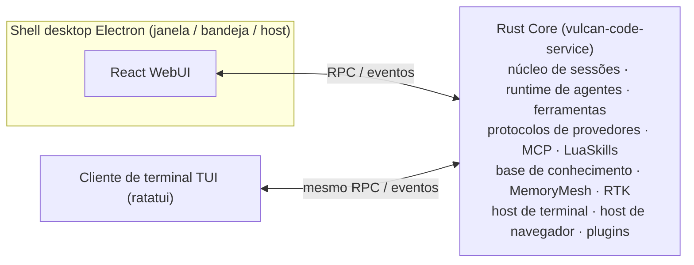

<div align="center">


# Vulcan Code

**Uma bancada de AI Coding de código aberto: aplicativo desktop com GUI + TUI para o terminal**

Rust Core · Shell desktop Electron · React WebUI · ratatui TUI

[](LICENSE)
[](https://github.com/OpenVulcan/vulcan-code/issues)
[](https://github.com/OpenVulcan/vulcan-code/pulls)

[简体中文](README.md) | [English](README.en.md) | [繁體中文](README.zh-TW.md) | [日本語](README.ja.md) | [한국어](README.ko.md) | [Español](README.es.md) | [Français](README.fr.md) | [Deutsch](README.de.md) | [Русский](README.ru.md) | **Português**

</div>

> Esta é uma tradução do [README em chinês simplificado](README.md). Em caso de divergência, prevalece a versão em chinês. Correções de tradução são bem-vindas via PR.

---

## Sobre o projeto

Vulcan Code é um **software de AI Coding** com dois clientes: um aplicativo desktop com GUI e uma TUI para o terminal. Ele reúne projetos, sessões, terminais, navegador, revisão de código e commits do Git em uma única bancada, para que a IA entenda seu código, avance nas tarefas e entregue resultados que você pode verificar.

O projeto foi desenvolvido e depurado internamente por um longo período e agora é de código aberto sob a **licença MIT**. Queremos que ele seja mais do que o produto de uma única equipe: uma ferramenta que a comunidade aprimora em conjunto.

- 🐛 Encontrou um problema ou tem uma ideia? Abra uma [Issue](https://github.com/OpenVulcan/vulcan-code/issues)
- 🔧 Corrigiu um bug ou criou um recurso? Envie um [Pull Request](https://github.com/OpenVulcan/vulcan-code/pulls)
- 🤝 Usuários e desenvolvedores são todos bem-vindos — vamos construir juntos um software de AI Coding que todos adorem

## Destaques

### 🧭 Bancada de desktop

- Gerenciamento de vários projetos e sessões, com painéis combináveis de arquivos, revisão, memória e subagentes
- Terminal de projeto integrado com abas; a IA pode manter sessões de comando longas ou interativas
- Respostas em streaming com Markdown, blocos de código, diagramas Mermaid/SVG e cartões de chamadas de ferramentas renderizados diretamente
- Edite uma pergunta anterior para gerar de novo, ou crie uma nova sessão a partir de qualquer turno concluído
- Interface em chinês e inglês, temas claro e escuro

### 💻 Cliente de terminal (TUI)

- A mesma bancada no terminal: projetos e sessões, conversa e raciocínio, chamadas de ferramentas, perguntas, alterações e commits do Git, além de memória, base de conhecimento, skills, agentes, gerenciamento de plugins e configurações do sistema
- Usa a mesma interface de serviço do WebUI e se conecta ao mesmo Core
- Suporte completo ao mouse: clique, clique duplo, menu de contexto e roda; paleta de comandos, comandos de barra e atalhos de teclado
- Abra pelo menu da bandeja ou compile e inicie com `make bt`; veja o [guia da TUI](apps/vulcan-code-tui/README.md)

### 🎯 Avançando nas tarefas

- **Modo Goal**: defina um objetivo e um orçamento de tokens; a IA continua trabalhando turno a turno, e você pode pausar, retomar ou limpar
- **Modo Plan**: primeiro explora e elabora um plano, e executa após sua confirmação
- **Orientação durante a execução**: adicione instruções ou enfileire novas solicitações enquanto uma tarefa está rodando
- **Subagentes**: papéis integrados como Explore e Plan, além de mais de 260 modelos de papéis do [agency-agents](https://github.com/msitarzewski/agency-agents) (desativados por padrão, ative conforme necessário)
- **Perguntas estruturadas**: quando a IA precisa de uma decisão sua, ela pergunta com cartões de opções

### 🧠 Entender o código e acumular experiência

- **Navegação de código CodeKit**: localização estrutural, busca textual, extração do corpo de funções e substituição de funções inteiras diretamente na árvore de trabalho ao vivo; não há índice pré-construído, então nada fica desatualizado. Conecte um serviço MCP externo quando precisar de busca semântica de código
- **Base de conhecimento gerenciada pela IA**: a IA organiza, lê e busca materiais de longo prazo com ferramentas dedicadas, com busca BM25, vetorial e híbrida; o histórico é mantido permanentemente e pode ser restaurado; acesso concedido por projeto e seleção por sessão
- **Memória de longo prazo MemoryMesh**: extrai experiência ao fim de cada turno e a recupera antes do próximo; as memórias podem ser visualizadas, corrigidas e excluídas, com lixeira e rastreamento de origem

### 🔍 Resultados verificáveis

- **Revisão de diffs**: visualização unificada/dividida, diferenças por palavra, busca em texto completo, stage e reversão
- **Commits do Git**: a IA gera a mensagem de commit; faça commit no branch atual ou em um novo e envie (push) diretamente
- **Navegador de IA**: a IA navega, clica, tira capturas de tela e lê o console em uma página real do Chromium; você pode assumir o controle a qualquer momento

### 🧩 Extensível

- **Skills de prompt** (`SKILL.md`): registre a forma de trabalhar da sua equipe e reutilize na próxima vez
- **LuaSkills**: empacote ações frequentes em pacotes de capacidades programáveis, configuráveis e instaláveis
- **MCP**: servidores MCP por processo local ou HTTP, com diagnóstico de conexão e inspeção de schemas de ferramentas
- **Serviço MCP**: o Vulcan também é um servidor MCP. Outras ferramentas de IA, como Claude Code e Codex, podem, conforme a permissão, listar projetos e sessões, enviar uma mensagem e aguardar a resposta, iniciar sessões, interromper execuções e responder perguntas, além de chamar modelos de imagem e vídeo liberados à parte; cada ferramenta tem o próprio token, e as aprovações de permissão ficam sempre no Vulcan
- **Sistema de plugins**: plugins podem fornecer ferramentas e montar sua própria interface. Plugins integrados: busca de documentação Context7, navegador de IA, estatísticas de uso, ferramentas de depuração CDP/DAP

### ⚙️ Modelos e provedores

- Suporte às famílias de protocolos OpenAI, Anthropic, Gemini e Cohere, com configurações integradas para OpenAI, Anthropic, Google, DeepSeek, Kimi, MiniMax, Alibaba, OpenRouter e outros; também é possível adicionar provedores personalizados
- Conversa, recuperação de memória, vetores da base de conhecimento e geração de mídia podem usar modelos diferentes
- Capacidades estendidas: busca e captura na web; compreensão de imagem, vídeo e áudio; geração de imagem e vídeo; síntese de voz e transcrição
- Políticas de janela de contexto em camadas, com compactação automática ou manual (`/compact`)
- **Compressão da saída de comandos RTK**: o RTK é integrado nativamente ao host e comprime a saída de comandos e o contexto de commits do Git para reduzir o consumo de tokens; pode ser ligado e desligado nas configurações, com estatísticas de economia
- Estatísticas de uso de tokens, latência e custo de referência

## Roadmap

Hoje estão disponíveis o **aplicativo desktop com GUI** e a **TUI para o terminal**. Próximos passos:

- [ ] **Conexão remota pelo celular**: visualizar e controlar pelo celular as sessões em execução no seu desktop
- [ ] **Validação em Linux / macOS**: os scripts de build já existem, falta a validação completa em cada plataforma

Se algum desses itens interessar a você, ou se tiver novas ideias, vamos conversar nas Issues.

## Arquitetura



O serviço Core pode rodar sozinho em segundo plano (bandeja do sistema); fechar a janela do desktop ou sair da TUI não interrompe as tarefas em andamento. O aplicativo desktop, o WebUI no navegador e a TUI se conectam ao mesmo Core.

| Diretório | Descrição |
| --- | --- |
| `apps/vulcan-code-service` | Host do serviço Core: núcleo de sessões, runtime de agentes e serviços RPC/streaming do WebUI |
| `apps/vulcan-code-desktop` | Shell desktop Electron: janela e bandeja; inicia o Core local e carrega o WebUI |
| `apps/vulcan-code-web` | WebUI React/Vite: bancada, configurações, sessões, diff, skills e mais |
| `apps/vulcan-code-tui` | Cliente de terminal TUI (ratatui): chama a mesma interface de serviço com as funções e parâmetros do WebUI |
| `crates/vulcan-agent-runtime` | Runtime compartilhado de agentes: provedores, ferramentas, LuaSkills, MCP, execução em streaming |
| `crates/vulcan-service-*` | API dos serviços de backend, núcleo do serviço Core e adaptadores de runtime |
| `crates/vulcan-memorymesh-*` | Memória de longo prazo MemoryMesh |
| `crates/vulcan-runtime-assets` | Recursos de referência: prompts de sistema, manifestos de provedores, modelos de subagentes |
| `plugins/` | Plugins integrados |
| `docs/contracts/` | Documentos de contratos de desenvolvimento |

## Primeiros passos

> A validação completa foi feita no **Windows x86_64**. Linux e macOS têm o script `make.sh` correspondente, mas ainda não foram testados de ponta a ponta — ajuda na validação é bem-vinda.

### Requisitos

- `make`
- [Rustup](https://rustup.rs/): a versão da toolchain é fixada em `rust-toolchain.toml` e instalada automaticamente
- PowerShell 7
- Node.js e pnpm

### Compilar e executar

```bash
make init-system   # Primeira vez: instala ferramentas Rust, dependências do host e Node/pnpm gerenciados
make sync          # Sincroniza configuração, skills do sistema, plugins e runtime do navegador em output/
make build         # Compila o Core, o WebUI e o shell desktop Electron
make run           # Inicia o aplicativo desktop
```

Também é possível usar `make br` para compilar e executar em um só passo; `make bt` faz um build completo, inicia o Core e abre a TUI, sem o aplicativo desktop nem o Vite. Para builds de release, use `make release`.

Veja [`docs/contracts/development-environment.md`](docs/contracts/development-environment.md) para detalhes do ambiente.

### Desenvolvimento no dia a dia

O servidor de desenvolvimento Vite, o serviço Core e o shell Electron são independentes e podem ser iniciados e reiniciados separadamente:

```bash
make vite start      # Inicia o servidor de desenvolvimento Vite do WebUI (também status / stop)
make service         # Inicia apenas o Core em segundo plano, sem abrir a janela
make core-restart    # Apenas mudanças no Core em Rust: build incremental e troca a quente do Core (Windows Debug)
make sync            # Sincronize novamente após alterar recursos, configuração, skills ou plugins
```

- Para mudanças apenas no WebUI, mantenha o Vite e o shell desktop rodando para ter hot reload
- No modo debug, `make run` / `make br` garantem que o Vite esteja em execução
- Não edite `output/` diretamente; os recursos de referência ficam em `crates/vulcan-runtime-assets/resources/`

## Como contribuir

Todo tipo de contribuição é bem-vindo: relatos de bugs, documentação, melhorias de UX, novas plataformas, novos provedores, plugins e skills…

**Abrindo uma Issue**

- Bugs: informe o sistema operacional, os passos para reproduzir, o comportamento esperado e o real, e logs ou capturas de tela relevantes
- Sugestões de recursos: descreva o caso de uso e o problema que deseja resolver

**Enviando um PR**

1. Faça um fork do repositório e crie um branch a partir de `main`
2. Antes de alterar qualquer coisa, leia o [`AGENTS.md`](AGENTS.md). Ele registra as convenções de longo prazo do repositório; para áreas específicas, leia também os documentos correspondentes em [`docs/contracts/`](docs/contracts/)
3. Valide localmente antes de enviar:

   ```bash
   # Rust: prefira verificações direcionadas aos crates alterados
   cargo check -p <crate> --all-targets
   cargo nextest run -p <crate>

   # WebUI
   pnpm --dir apps/vulcan-code-web run lint
   pnpm --dir apps/vulcan-code-web run test
   pnpm --dir apps/vulcan-code-web run build
   ```

4. Na descrição do PR, explique o que mudou, por que e como você validou

Algumas convenções:

- Nomes, descrições e schemas de ferramentas voltados à IA são escritos em inglês; os textos da interface para o usuário são localizados
- A concorrência de build e testes é limitada a 4 por padrão; não remova esse limite nos comandos de validação
- Procure fazer cada PR tratar de uma única coisa, para facilitar a revisão

## Agradecimentos

O Vulcan Code é construído sobre muitos projetos de código aberto excelentes. Obrigado aos seus autores e comunidades.

**Componentes e ferramentas integrados**

- [RTK](https://github.com/rtk-ai/rtk): compressão da saída de comandos para economizar tokens (integrado nativamente ao host)
- [Context7](https://github.com/upstash/context7): documentação de bibliotecas atualizada e específica por versão (plugin Context7)
- [Playwright](https://github.com/microsoft/playwright) / [Playwright MCP](https://github.com/microsoft/playwright-mcp): driver e ferramentas do navegador de IA
- [LuaSkills](https://github.com/LuaSkills/luaskills): runtime do LuaSkills
- [ripgrep](https://github.com/BurntSushi/ripgrep) e [ast-grep](https://github.com/ast-grep/ast-grep): ferramentas incluídas de busca textual e em árvore sintática

**Desktop e interface**

- [Electron](https://www.electronjs.org/): shell desktop
- [React](https://react.dev/) e [Vite](https://vite.dev/): framework e ferramenta de build do WebUI
- [shadcn/ui](https://ui.shadcn.com/), [Radix UI](https://www.radix-ui.com/), [Tailwind CSS](https://tailwindcss.com/): componentes e estilos
- [xterm.js](https://xtermjs.org/): renderização do terminal
- [Shiki](https://shiki.style/): realce de sintaxe de código e diffs
- [Mermaid](https://mermaid.js.org/): renderização de diagramas
- [Lucide](https://lucide.dev/), [Iconify](https://iconify.design/): ícones

**Cliente de terminal**

- [Ratatui](https://ratatui.rs/): framework de renderização da TUI

**Rust Core**

- [Tokio](https://tokio.rs/) e [Axum](https://github.com/tokio-rs/axum): runtime assíncrono e framework de serviços
- [rmcp](https://github.com/modelcontextprotocol/rust-sdk): SDK oficial de MCP para Rust
- [LanceDB](https://github.com/lancedb/lancedb) e [Apache Arrow](https://arrow.apache.org/): índice vetorial e dados colunares
- [SQLite](https://sqlite.org/) ([rusqlite](https://github.com/rusqlite/rusqlite)): armazenamento local de dados
- [jieba-rs](https://github.com/messense/jieba-rs): segmentação de texto em chinês para a busca em texto completo da base de conhecimento
- [portable-pty](https://github.com/wezterm/wezterm) (WezTerm): pseudoterminal multiplataforma

**Referências de design e implementação**

- [OpenAI Codex](https://github.com/openai/codex): referência para o transporte do protocolo Responses, novas tentativas e compactação de contexto; a gramática e o analisador em streaming do Apply Patch são adaptados do Codex
- [cc-switch](https://github.com/farion1231/cc-switch): referência para conversão multiprotocolo, chamadas de ferramentas em streaming e dados de preços de modelos
- [CLIProxyAPI](https://github.com/router-for-me/CLIProxyAPI): referência para o protocolo Gemini e a conversão de compatibilidade
- [OpenCode](https://github.com/anomalyco/opencode): referência para catálogos de provedores e prompts de sistema
- [agency-agents](https://github.com/msitarzewski/agency-agents): origem dos modelos de papéis de subagentes
- [Answer me with HTML](https://github.com/QingYunA/answer-me-with-html): inspiração para respostas HTML, rascunhos compactos e componentes de modelos; o protocolo, o renderizador integrado e o visualizador isolado são próprios e não dependem de sua CLI

**Comunidade**

- [LINUX DO](https://linux.do/): obrigado à comunidade LINUX DO pelo apoio e pelas trocas

A lista completa de dependências de terceiros e suas licenças está em [`THIRD_PARTY_NOTICES.md`](crates/vulcan-runtime-assets/resources/licenses/THIRD_PARTY_NOTICES.md); também é possível consultá-la no aplicativo em **Settings → About and licenses**.

## Licença

[MIT](LICENSE) © 2026 OpenVulcan
