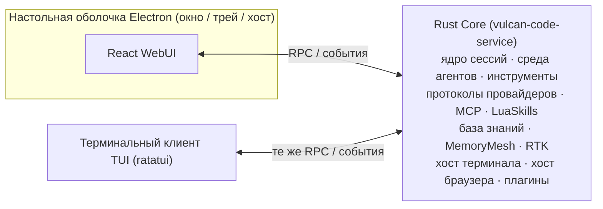

<div align="center">


# Vulcan Code

**Открытая среда для AI Coding: настольное GUI-приложение + TUI для терминала**

Rust Core · настольная оболочка Electron · React WebUI · ratatui TUI

[](LICENSE)
[](https://github.com/OpenVulcan/vulcan-code/issues)
[](https://github.com/OpenVulcan/vulcan-code/pulls)

[简体中文](README.md) | [English](README.en.md) | [繁體中文](README.zh-TW.md) | [日本語](README.ja.md) | [한국어](README.ko.md) | [Español](README.es.md) | [Français](README.fr.md) | [Deutsch](README.de.md) | **Русский** | [Português](README.pt-BR.md)

</div>

> Это перевод [README на упрощённом китайском](README.md). При расхождениях приоритет имеет китайская версия. Исправления перевода принимаются через PR.

---

## О проекте

Vulcan Code — это **приложение для AI Coding** с двумя клиентами: настольным GUI-приложением и TUI для терминала. Оно объединяет проекты, сессии, терминалы, браузер, ревью кода и коммиты Git в единой рабочей среде, чтобы ИИ понимал ваш код, продвигал задачи и выдавал результаты, которые можно проверить.

Проект долгое время разрабатывался и отлаживался внутри команды, а теперь открыт под **лицензией MIT**. Мы хотим, чтобы он стал не продуктом одной команды, а инструментом, который сообщество развивает вместе:

- 🐛 Нашли проблему или есть идея? Создайте [Issue](https://github.com/OpenVulcan/vulcan-code/issues)
- 🔧 Исправили ошибку или сделали новую функцию? Отправьте [Pull Request](https://github.com/OpenVulcan/vulcan-code/pulls)
- 🤝 Присоединиться может каждый — и пользователи, и разработчики. Давайте вместе создадим AI Coding-инструмент, который полюбят все

## Ключевые возможности

### 🧭 Настольная среда

- Управление несколькими проектами и сессиями, свободная компоновка панелей файлов, ревью, памяти и субагентов
- Встроенный терминал проекта с вкладками; ИИ может удерживать долгоживущие или интерактивные командные сессии
- Потоковые ответы с отрисовкой Markdown, блоков кода, диаграмм Mermaid/SVG и карточек вызовов инструментов прямо в ленте
- Можно отредактировать прошлый запрос и сгенерировать ответ заново или ответвить новую сессию от любого завершённого хода
- Интерфейс на китайском и английском, светлая и тёмная темы

### 💻 Терминальный клиент (TUI)

- Та же рабочая среда в терминале: проекты и сессии, диалог и ход рассуждений, вызовы инструментов, вопросы, изменения и коммиты Git, а также память, база знаний, навыки, агенты, управление плагинами и системные настройки
- Использует тот же сервисный интерфейс, что и WebUI, и подключается к тому же Core
- Полная поддержка мыши: щелчок, двойной щелчок, контекстное меню и колесо; палитра команд, слэш-команды и сочетания клавиш
- Открывается из меню в трее или собирается и запускается командой `make bt`; подробнее — в [руководстве по TUI](apps/vulcan-code-tui/README.md)

### 🎯 Продвижение задач

- **Режим Goal**: задайте цель и бюджет токенов — ИИ продолжает работу ход за ходом; цель можно приостановить, возобновить или сбросить
- **Режим Plan**: сначала исследование и план, выполнение — после вашего подтверждения
- **Управление на ходу**: добавляйте указания или ставьте последующие запросы в очередь, пока задача выполняется
- **Субагенты**: встроенные роли, такие как Explore и Plan, а также более 260 шаблонов ролей из [agency-agents](https://github.com/msitarzewski/agency-agents) (по умолчанию отключены, включаются по необходимости)
- **Структурированные вопросы**: когда ИИ нужно ваше решение, он задаёт вопрос с карточками вариантов

### 🧠 Понимание кода и накопление опыта

- **Навигация по коду CodeKit**: поиск по структуре, текстовый поиск, извлечение тел функций и замена функций целиком прямо в актуальном рабочем дереве; заранее построенного индекса нет, поэтому ничего не устаревает. Для семантического поиска по коду можно подключить внешний MCP-сервис
- **База знаний под управлением ИИ**: ИИ упорядочивает, читает и ищет долгосрочные материалы с помощью отдельных инструментов, поиск BM25, векторный и гибридный; история хранится бессрочно и может быть восстановлена; доступ выдаётся на уровне проекта, выбор — на уровне сессии
- **Долговременная память MemoryMesh**: после каждого хода извлекает опыт и автоматически вспоминает его перед следующим; воспоминания можно просматривать, исправлять и удалять, есть корзина и отслеживание источников

### 🔍 Проверяемые результаты

- **Ревью диффов**: единый и раздельный вид, различия на уровне слов, полнотекстовый поиск, индексирование (stage) и откат
- **Коммиты Git**: ИИ генерирует сообщение коммита, коммит в текущую или новую ветку и сразу push
- **ИИ-браузер**: ИИ переходит по страницам, кликает, делает скриншоты и читает консоль в настоящей странице Chromium; вы можете в любой момент перехватить управление

### 🧩 Расширяемость

- **Prompt-навыки** (`SKILL.md`): зафиксируйте подходы вашей команды и переиспользуйте их в следующий раз
- **LuaSkills**: упаковывайте частые действия в настраиваемые и устанавливаемые программные пакеты возможностей
- **MCP**: MCP-серверы в виде локального процесса или по HTTP, с диагностикой подключения и просмотром схем инструментов
- **Служба MCP**: Vulcan и сам является MCP-сервером. Другие ИИ-инструменты, например Claude Code и Codex, могут в пределах выданных прав просматривать проекты и сеансы, отправлять сообщение и ждать ответа, начинать сеансы, останавливать выполнение и отвечать на вопросы, а также вызывать отдельно разрешённые модели изображений и видео; у каждого инструмента свой токен, а одобрение разрешений всегда остаётся в Vulcan
- **Система плагинов**: плагины могут предоставлять инструменты и встраивать собственный интерфейс. Встроенные плагины: поиск документации Context7, ИИ-браузер, статистика использования, инструменты отладки CDP/DAP

### ⚙️ Модели и провайдеры

- Поддержка семейств протоколов OpenAI, Anthropic, Gemini и Cohere; встроенные конфигурации для OpenAI, Anthropic, Google, DeepSeek, Kimi, MiniMax, Alibaba, OpenRouter и других; можно добавлять собственных провайдеров
- Для диалога, извлечения памяти, векторов базы знаний и генерации медиа можно выбрать разные модели
- Расширенные возможности: веб-поиск и загрузка страниц; понимание изображений, видео и аудио; генерация изображений и видео; синтез речи и транскрибация
- Многоуровневые политики контекстного окна, автоматическое или ручное (`/compact`) сжатие контекста
- **Сжатие вывода команд RTK**: RTK встроен в хост нативно и сжимает вывод команд и контекст коммитов Git, сокращая расход токенов; включается в настройках, там же видна статистика экономии
- Статистика расхода токенов, задержек и ориентировочной стоимости

## Дорожная карта

Сейчас доступны **настольное GUI-приложение** и **TUI для терминала**. Дальше в планах:

- [ ] **Удалённое подключение с телефона**: просмотр и управление сессиями, запущенными на компьютере, со смартфона
- [ ] **Проверка на Linux / macOS**: скрипты сборки уже есть, нужна полная проверка на каждой платформе

Если вас заинтересовал какой-то пункт или есть новые идеи — обсудим в Issues.

## Архитектура



Сервис Core может работать самостоятельно в фоне (в системном трее); ни закрытие окна приложения, ни выход из TUI не прерывают выполняемые задачи. Настольное приложение, WebUI в браузере и TUI подключаются к одному и тому же Core.

| Каталог | Описание |
| --- | --- |
| `apps/vulcan-code-service` | Хост сервиса Core: ядро сессий, среда выполнения агентов и RPC/потоковые сервисы для WebUI |
| `apps/vulcan-code-desktop` | Настольная оболочка Electron: окно и трей; запускает локальный Core и загружает WebUI |
| `apps/vulcan-code-web` | WebUI на React/Vite: рабочая среда, настройки, сессии, диффы, навыки и другое |
| `apps/vulcan-code-tui` | Терминальный клиент TUI (ratatui): вызывает тот же сервисный интерфейс с функциями и параметрами WebUI |
| `crates/vulcan-agent-runtime` | Общая среда выполнения агентов: провайдеры, инструменты, LuaSkills, MCP, потоковое выполнение |
| `crates/vulcan-service-*` | API бэкенд-сервисов, ядро сервиса Core и адаптеры среды выполнения |
| `crates/vulcan-memorymesh-*` | Долговременная память MemoryMesh |
| `crates/vulcan-runtime-assets` | Эталонные ресурсы: системные промпты, манифесты провайдеров, шаблоны субагентов |
| `plugins/` | Встроенные плагины |
| `docs/contracts/` | Документы с контрактами разработки |

## Быстрый старт

> Полная проверка выполнена на **Windows x86_64**. Для Linux и macOS есть соответствующий скрипт `make.sh`, но сквозная проверка ещё не проводилась — будем рады помощи.

### Требования

- `make`
- [Rustup](https://rustup.rs/): версия тулчейна закреплена в `rust-toolchain.toml` и устанавливается автоматически
- PowerShell 7
- Node.js и pnpm

### Сборка и запуск

```bash
make init-system   # Первый раз: установка инструментов Rust, зависимостей хоста и управляемых Node/pnpm
make sync          # Синхронизация конфигурации, системных навыков, плагинов и браузерной среды в output/
make build         # Сборка Core, WebUI и настольной оболочки Electron
make run           # Запуск настольного приложения
```

Можно также собрать и запустить одной командой `make br`; `make bt` выполняет полную сборку, запускает Core и открывает TUI без настольного приложения и Vite. Для релизной сборки используйте `make release`.

Подробности об окружении — в [`docs/contracts/development-environment.md`](docs/contracts/development-environment.md).

### Повседневная разработка

Dev-сервер Vite, сервис Core и оболочка Electron независимы друг от друга и запускаются/перезапускаются по отдельности:

```bash
make vite start      # Запуск dev-сервера Vite для WebUI (также status / stop)
make service         # Запуск только фонового Core, без окна приложения
make core-restart    # Изменён только Rust Core: инкрементальная сборка и горячая замена Core (Windows Debug)
make sync            # Повторная синхронизация после изменения ресурсов, конфигурации, навыков или плагинов
```

- При изменениях только в WebUI оставьте Vite и настольную оболочку запущенными — сработает горячая перезагрузка
- В режиме debug `make run` / `make br` сами проверяют, что Vite запущен
- Не редактируйте `output/` напрямую; эталонные ресурсы находятся в `crates/vulcan-runtime-assets/resources/`

## Участие в разработке

Мы рады любому вкладу: сообщениям об ошибках, документации, улучшениям UX, поддержке новых платформ и провайдеров, плагинам и навыкам…

**Создание Issue**

- Ошибки: укажите ОС, шаги воспроизведения, ожидаемое и фактическое поведение, приложите логи или скриншоты
- Предложения: опишите сценарий использования и проблему, которую хотите решить

**Отправка PR**

1. Сделайте форк репозитория и создайте ветку от `main`
2. Перед изменениями прочитайте [`AGENTS.md`](AGENTS.md). В нём описаны долгосрочные соглашения репозитория; для отдельных областей также прочитайте соответствующие документы в [`docs/contracts/`](docs/contracts/)
3. Перед отправкой проверьте изменения локально:

   ```bash
   # Rust: предпочтительно точечные проверки изменённых crate
   cargo check -p <crate> --all-targets
   cargo nextest run -p <crate>

   # WebUI
   pnpm --dir apps/vulcan-code-web run lint
   pnpm --dir apps/vulcan-code-web run test
   pnpm --dir apps/vulcan-code-web run build
   ```

4. В описании PR объясните, что и зачем изменено и как это проверено

Несколько соглашений:

- Названия, описания и схемы инструментов для ИИ пишутся на английском; тексты интерфейса для пользователей локализуются
- Параллелизм сборки и тестов по умолчанию ограничен 4; не снимайте это ограничение в командах проверки
- Старайтесь, чтобы один PR решал одну задачу — так проще проводить ревью

## Благодарности

Vulcan Code построен на множестве замечательных open-source проектов. Спасибо их авторам и сообществам.

**Встроенные компоненты и инструменты**

- [RTK](https://github.com/rtk-ai/rtk): сжатие вывода команд для экономии токенов (нативно встроен в хост)
- [Context7](https://github.com/upstash/context7): актуальная документация библиотек с учётом версии (плагин Context7)
- [Playwright](https://github.com/microsoft/playwright) / [Playwright MCP](https://github.com/microsoft/playwright-mcp): драйвер и инструменты ИИ-браузера
- [LuaSkills](https://github.com/LuaSkills/luaskills): среда выполнения LuaSkills
- [ripgrep](https://github.com/BurntSushi/ripgrep) и [ast-grep](https://github.com/ast-grep/ast-grep): поставляемые инструменты текстового поиска и поиска по синтаксическому дереву

**Настольное приложение и интерфейс**

- [Electron](https://www.electronjs.org/): настольная оболочка
- [React](https://react.dev/) и [Vite](https://vite.dev/): фреймворк и инструмент сборки WebUI
- [shadcn/ui](https://ui.shadcn.com/), [Radix UI](https://www.radix-ui.com/), [Tailwind CSS](https://tailwindcss.com/): компоненты и стили
- [xterm.js](https://xtermjs.org/): отрисовка терминала
- [Shiki](https://shiki.style/): подсветка синтаксиса кода и диффов
- [Mermaid](https://mermaid.js.org/): отрисовка диаграмм
- [Lucide](https://lucide.dev/), [Iconify](https://iconify.design/): иконки

**Терминальный клиент**

- [Ratatui](https://ratatui.rs/): фреймворк отрисовки TUI

**Rust Core**

- [Tokio](https://tokio.rs/) и [Axum](https://github.com/tokio-rs/axum): асинхронная среда выполнения и фреймворк сервисов
- [rmcp](https://github.com/modelcontextprotocol/rust-sdk): официальный Rust SDK для MCP
- [LanceDB](https://github.com/lancedb/lancedb) и [Apache Arrow](https://arrow.apache.org/): векторный индекс и колоночные данные
- [SQLite](https://sqlite.org/) ([rusqlite](https://github.com/rusqlite/rusqlite)): локальное хранение данных
- [jieba-rs](https://github.com/messense/jieba-rs): сегментация китайского текста для полнотекстового поиска в базе знаний
- [portable-pty](https://github.com/wezterm/wezterm) (WezTerm): кроссплатформенный псевдотерминал

**Референсы для проектирования и реализации**

- [OpenAI Codex](https://github.com/openai/codex): референс для транспорта протокола Responses, повторных попыток и сжатия контекста; грамматика Apply Patch и потоковый парсер адаптированы из Codex
- [cc-switch](https://github.com/farion1231/cc-switch): референс для мультипротокольного преобразования, потоковых вызовов инструментов и данных о ценах моделей
- [CLIProxyAPI](https://github.com/router-for-me/CLIProxyAPI): референс для протокола Gemini и совместимых преобразований
- [OpenCode](https://github.com/anomalyco/opencode): референс для каталогов провайдеров и системных промптов
- [agency-agents](https://github.com/msitarzewski/agency-agents): источник шаблонов ролей субагентов
- [Answer me with HTML](https://github.com/QingYunA/answer-me-with-html): идея HTML-ответов, кратких черновиков и шаблонных компонентов; протокол, встроенный рендерер и изолированный просмотрщик реализованы самостоятельно, без зависимости от CLI этого проекта

**Сообщество**

- [LINUX DO](https://linux.do/): спасибо сообществу LINUX DO за поддержку и общение

Полный список сторонних зависимостей и их лицензий — в [`THIRD_PARTY_NOTICES.md`](crates/vulcan-runtime-assets/resources/licenses/THIRD_PARTY_NOTICES.md); в приложении его можно посмотреть в разделе **Settings → About and licenses**.

## Лицензия

[MIT](LICENSE) © 2026 OpenVulcan
