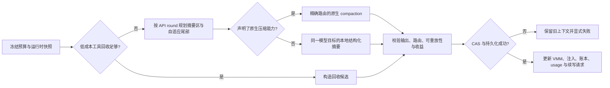

# 上下文压缩机制跨项目分析报告

> 状态：已完成六个项目的第一轮源码级对照与报告整理。
>
> 分析日期：2026-08-12

## 1. 报告目标

本报告分析当前 `vulcan-code` 项目的上下文压缩规则，并与以下五个项目进行源码级对照：

- `D:\openvulcan\third_git\kimi-cli`
- `D:\openvulcan\third_git\codex`
- `D:\openvulcan\third_git\OpenCode\opencode`
- `D:\openvulcan\third_git\hermes-agent`
- `D:\openvulcan\third_git\DeepSeek-Reasonix`

分析重点不是界面或产品文案，而是还原每个项目的真实压缩链路：触发条件、预算口径、压缩输入、保留范围、摘要生成、消息重建、工具与附件处理、失败策略、持久化与恢复、模型和协议耦合，以及相应测试覆盖。

## 2. 证据标准与快照

1. 以当前检出提交的源码、类型定义、配置和测试为主要证据；文档只用于解释设计意图。
2. 若文档与代码冲突，以运行时代码为准并记录差异。
3. 将“源码已实现”“测试已覆盖”与“真实 Provider 端到端验证”分开表述。
4. 不把普通历史裁剪、消息过滤、缓存复用或外部记忆检索直接等同于上下文压缩。
5. 可借鉴建议必须回到 `vulcan-code` 的现有架构、协议边界和失败语义，不建议无依据的多协议探测或猜测式兼容。

本轮分析基于以下仓库快照：

| 项目 | 提交 | 分支 | 工作区说明 |
|---|---|---|---|
| `vulcan-code` | `8734445a9dbb2a45afe656688fb892b7774bcddd` | `main` | 原工作区已有大量未提交变更；本报告只新增本文件，不触碰其他变更 |
| `kimi-cli` | `cbc15c076d17f70fec9f89c90c0502e68657f505` | `main` | 干净 |
| `codex` | `2230d64464488d8847197722fdca09d90095c705` | `main` | 存在未跟踪 `.qwen/`、`.vulcan/` |
| `OpenCode/opencode` | `1f94d8a3c86b67f4f49a0e341de74e9188381b3a` | `dev` | 干净 |
| `hermes-agent` | `5d3be898a8671eb9fb99cf18f43165502f54e7f4` | `main` | 干净 |
| `DeepSeek-Reasonix` | `e6d542bc944de30435a4dc38fcec6fcc6e552591` | `main-v2` | 干净 |

## 3. 研究维度

- 何时触发：固定 token 阈值、比例、预留输出、Provider 溢出、用户命令、模型切换或缓存压力。
- 如何计量：宿主估算、Provider usage、当前待发送输入、工具 schema、缓存前缀是否计入。
- 压缩什么：system、developer、user、assistant、reasoning、tool call/result、附件、注入状态和 Provider 私有状态。
- 保留什么：最近消息、完整 API round、用户原话、工具结构、媒体、先前摘要和 checkpoint。
- 如何重建：摘要消息、原生 compaction item、替换历史、投影视图、续写提示或新上下文窗口。
- 如何失败：终止、重试、裁剪后重试、模型回退、协议回退或 fail-closed。
- 如何恢复：文件旋转、事件追加、事务候选、checkpoint、fork/resume/replay。

## 4. 结论总览

当前四个已核对项目代表四种明显不同的取向：

- `vulcan-code`：强调精确预算、路由冻结、候选草稿、Provider 原生压缩与本地摘要双路径，以及 VMM、注入、账本、checkpoint 的全链一致性；能力最完整，同时复杂度最高。
- `kimi-cli`：规则短而清晰，以“比例阈值或固定预留”触发，摘要旧消息并原样保留最近两个 user/assistant 消息；容易审计，但对工具轮次、媒体、中文估算和原子持久化的保护较弱。
- `codex`：把压缩纳入 pre-turn、mid-turn、模型切换和 Provider 能力声明，原生 Responses V2 路径最值得关注；本地路径仍以最近真实用户消息为尾部，语义保真度与原生路径存在明显差异。
- `OpenCode/opencode`：采用“头部摘要 + 自适应近期尾部 + 先前摘要递增合并 + 追加式历史投影”，并把工具输出清理作为独立低成本层；设计清晰，但仓库内 V1 与 core 新路径并存，尚未完全收敛。
- `hermes-agent`：采用“工具输出预压缩 + 固定头部 + 比例化尾部 + 递增摘要”，重点解决工具配对、首尾角色、当前任务和多次压缩退化；覆盖面广，但摘要失败时会机械删除中段，失败安全性偏弱。
- `DeepSeek-Reasonix`：以单一 85% 自动阈值、不可变规范历史、原子 sidecar 投影、CAS 提交和单次摘要事务为核心；状态一致性和重启恢复设计最系统，但物理溢出时允许无语义摘要的机械折叠，仍存在明确的数据丢失边界。

## 5. `vulcan-code` 当前实现

### 5.1 预算与触发规则

核心预算定义位于 `crates/vulcan-context`：

- 默认硬上限是模型原始上下文窗口的 95%。硬准入始终按 `Total` 口径判断，避免因为缓存前缀或固定前缀被排除后突破模型真实上限。
- 默认自动压缩线是原始窗口的 90%；可以配置绝对 token 线，并与百分比线取更保守值。
- 自动压缩的作用域可以是 `Total`，也可以是 `BodyAfterPrefix`。后者只影响“何时提前压缩”，不改变硬上限。
- 预算同时估算 system/history/current prompt/tools；若存在同一 Provider 调用基线下的 usage，则用 Provider 已观测输入补强宿主估算。
- 默认策略为 `auto=true`、`prune=true`、`tail_turns=3`、`preserve_recent_tokens=10_000`。
- 快照不仅记录 token 数，还记录模型路由、模型、配置画像、Provider 调用锚点、前缀基线与指纹。自动压缩只有在预算快照仍与当前运行时匹配时才执行，避免使用过期判断。

触发分为多条链路：

1. 用户轮次在发送 Provider 请求前进行预算判断。
2. Provider 或工具边界后，若得到可验证的上下文溢出，可以强制进入自动压缩。
3. VMM 缓存压力也可根据可回收锚点触发压缩。
4. 手动压缩支持显式来源边界，而不是只能压缩全部旧历史。

### 5.2 规划、摘要与历史重建

压缩不是直接原地改历史，而是先构造计划，再在克隆输入上做预算适配：

- 计划记录稳定的绝对 turn 索引、压缩来源边界和保留尾部起点。
- 先前摘要会进入下一轮摘要输入，支持多次压缩后的递增合并。
- 输入过大时，先压缩旧工具输出；错误关键输出和结构关键元数据受到保护。仍超限时才丢弃最旧片段，最后才截断单个超大来源。
- 近期尾部按 API round 分组，而不是简单按消息数量截取；目标由 `tail_turns` 和 `preserve_recent_tokens` 共同限制。工具调用与结果尽量作为完整轮次保留。
- 摘要提示要求固定结构：目标、约束与偏好、进度、关键决策、技术上下文、文件与符号、错误与修复、用户消息与纠正、下一步。模型的私有分析不会进入持久摘要。

摘要成功后先生成候选草稿：

- 摘要记录对用户不可见，并带 checkpoint、预算指纹、装配指纹和上下文起始锚点。
- 只覆盖精确的 `source_until_message_id`，然后拼接其后的真实消息；边界校验失败不会部分写入。
- 自动压缩会追加一条合成续写用户消息，包含最近真实用户意图的受限长度副本，要求模型直接继续而不是重新问候或复述。
- 上下文注入、VMM cache epoch、Provider 调用账本 generation 和 prefill baseline 会随候选提交一起更新。
- 成功后才持久化并刷新后续执行请求；失败不会移动压缩锚点。连续自动压缩失败达到上限后会终止当前请求，而不是带着不可信状态继续。

### 5.3 Provider 原生路径与本地路径

`vulcan-code` 同时支持声明式 Provider 原生压缩和本地摘要：

- 是否使用远端 `/responses/compact` 由已声明的路由画像决定，不做跨协议探测。
- 压缩绑定精确 provider、connection、model、route lease 和协议画像；执行期间工具路由发生变化会失败关闭。
- 远端压缩复用普通请求的工具快照、schema、原生工具和基础指令；输出的 opaque compaction state 只有在完整路由身份匹配且所有 item 可重放时才会装入历史。
- 远端失败只有在尚未产生语义输出或副作用、且不是 401/403 这类认证权限失败时，才允许回到同一精确模型目标的本地摘要。这不是跨协议探测式降级。
- 本地摘要使用 service 注入的 Public AI runtime。当前源码已确认压缩构造会把该运行时传到隔离启动链，避免压缩任务落回缺失 Public AI runtime 的旧路径。
- 本地路径默认先尝试全保真输入；明确溢出或估算已超目标时转为裁剪输入。普通失败最多重试三次，然后才进入克隆裁剪模式；溢出识别仍依赖一组错误字符串。

### 5.4 优点

- 硬上限与自动压缩作用域分离，预算语义严谨。
- Provider usage、宿主估算、待发送上下文和工具 schema 同时进入预算，较少出现单一估算源偏差。
- 路由身份冻结、Provider opaque state 可重放校验和 fail-closed 边界强。
- 候选草稿、精确来源边界、checkpoint 和提交后刷新构成较完整的事务式思路。
- 近期尾部按 API round 保留，优于按最后 N 条消息截断。
- 压缩与 VMM、注入、Provider 调用账本、缓存 epoch、用量分段联动，能够维护全链一致性。

### 5.5 局限与风险

- 实现分布在 context、compaction planner、agent runtime、service kernel、prompt composer 与 VMM 链路，状态空间很大，维护成本明显高于其他项目。
- 本地普通错误最多三次全保真重试、之后再裁剪重试，可能造成额外时延和 token 成本；应继续收紧“哪些错误值得重试”的分类。
- 溢出错误的快速识别依赖字符串集合，Provider 新错误形态可能漏判或误判。
- 固定 10,000 token 的近期保留预算对不同上下文窗口不够自适应。
- 当前检查是静态源码和测试结构核对，本轮未重新执行真实 Provider 端到端压缩。

## 6. `kimi-cli` 实现特点

### 6.1 触发与预算

`src/kimi_cli/soul/compaction.py` 与 `context.py` 的规则非常直接：

- 默认 `compaction_trigger_ratio=0.85`、`reserved_context_size=50_000`。
- 当 `token_count >= max_context * ratio`，或 `token_count + reserved_context_size >= max_context` 时触发，取两条规则中更早的一条。
- 因此 200k 窗口默认约在 150k 触发，而 1M 窗口约在 850k 触发。固定 50k 预留对小窗口影响更强。
- 计量使用 `token_count_with_pending`，会把当前尚未落入稳定历史的待处理输入估算进去。
- 每个 LLM step 前检查；压缩失败直接让该 step 失败，不携带超限上下文继续。

### 6.2 压缩方法

- 默认保留最近两个 role 为 user/assistant 的消息，并从较早者开始把其后的所有消息和 part 原样保留。
- 更老消息转成带 `## Message N` 和角色标题的纯文本；只保留 `TextPart`，旧媒体、thinking、tool call/result 等结构化 part 不进入摘要输入。
- 使用同一个 LLM/provider、空工具集和专用摘要提示生成结果。
- 输出移除 thinking，包装成 role=`user` 的合成消息，内部带“先前上下文已压缩”的 system 内容前缀，然后接上保留尾部。
- 手动 `/compact` 支持附加自定义指令，用于告诉摘要器本次重点。
- 摘要结构包括当前焦点、环境、已完成任务、活动问题、代码状态和重要上下文，并特别要求保留完整错误、最终方案与关键代码。

### 6.3 持久化与生命周期

- 压缩请求对可重试连接错误使用指数抖动重试，默认每 step 最多三次。
- 提供 PreCompact/PostCompact hooks、CompactionBegin/End 事件和遥测。
- 成功后才旋转旧 context 文件为备份、建立新文件并依次写入 system prompt、checkpoint、压缩结果、活动后台任务快照和估算 token。
- 动态注入 provider 会收到重置通知，避免一次性注入状态在压缩后丢失或错误复用。

### 6.4 优点

- 策略短、易理解、易测试；失败语义明确。
- `pending` 输入进入触发预算，降低“检查时没超、真正发送时超限”的风险。
- 手动压缩焦点是低成本但实用的产品能力。
- 后台任务快照、动态注入重置和文件备份体现了对压缩后连续执行的关注。

### 6.5 局限

- 最近两个 user/assistant 消息不是 API round 边界，可能拆开工具调用与结果。
- 旧历史只取文本，工具、媒体和推理结构可能永久丢失。
- 保留消息用字符数除以四估算，中文场景容易低估，虽会在下一次真实 usage 后修正，但触发点仍可能滞后。
- 摘要器必须吃下完整旧文本，没有像 `vulcan-code` 那样的分层输入裁剪计划。
- 文件旋转后逐项重写不是单一原子事务；备份可恢复，但崩溃窗口仍可能留下不完整活动文件。

## 7. `codex` 实现特点

### 7.1 触发阶段和路由

`codex-rs/core` 将压缩放在多个执行阶段：

- pre-turn：在新一轮开始前根据已知上下文状态判断，但源码仍有 TODO，尚未把即将加入的 user input 完整估进这次判断。
- mid-turn：Provider 或工具步骤后，只有还需要 follow-up 且达到阈值或显式请求新 context 时压缩。
- 模型切换：若 compaction 配置哈希变化，或切到更小窗口后会超限，会先用旧模型压缩。
- 手动 compact：走同一套声明式路由选择。

预算区分 Total 与 BodyAfterPrefix，但硬模型窗口仍是最终上限。远端能力由 provider 的 `RemoteCompactionSupport` 声明：支持 V2 且 feature 开启时用 V2，声明 V1/V2 时可用 V1，否则走本地；不通过试错探测能力。

### 7.2 本地压缩

- 把完整 history 加摘要提示发给普通 Responses 流；遇到 ContextWindowExceeded 时逐条删除最旧 history item，直到能发送。
- 结果取最后一条 assistant 文本，加固定 summary prefix。
- 重建时只保留最近真实 user 消息，合计上限约 20k token，再追加摘要作为 user 消息；近期 assistant、工具轮次不是本地尾部的主要保留对象。
- pre-turn、manual、mid-turn 对初始上下文 reinjection 的位置不同，目的是保持摘要 item 与接续轮次的顺序正确。
- 本地压缩后明确警告：长线程和多次压缩会降低准确性，必要时开启新任务。

### 7.3 Responses 原生 V1/V2

V1 使用 `/responses/compact`，然后过滤并替换历史。它会丢弃 developer、工具、reasoning、call/result 等 item，再重新注入规范初始上下文；服务端规范化 item 会导致 harness metadata sidecar 丢失。

V2 更完整：

- 在发送前只在历史确实超过完整窗口时裁剪近期 function call output。
- 发送完整投影历史、同一工具集合、基础指令和 CompactionTrigger。
- 要求返回 `response.completed`，且输出中恰好有一个 `ResponseItem::Compaction`；否则失败。
- 重建时按总计约 64k、单个 agent 消息约 10k 的预算保留最新真实 user/agent 消息，并感知图片，再追加 opaque compaction item。
- 保留 metadata sidecar，追踪 window id、attempt 和触发原因。

另有实验性 TokenBudget 模式：让模型提前写持久笔记，达到边界时直接开启只含新 WorldState 的窗口，不调用摘要模型。它成本低，但强依赖模型在切窗前正确沉淀信息，因此不宜直接作为默认方案。

### 7.4 持久化与恢复

压缩后的 replacement history 会先更新活动状态，再作为 `RolloutItem::Compacted` 追加到 rollout；随后追加 world state 与 turn context。追加式记录有利于 resume、fork、rollback 和重放，但活动状态更新与多条持久记录不是单一原子提交。

### 7.5 可借鉴点与局限

可借鉴：

- 模型切换前压缩与 compaction 配置哈希，可防止切窗后才发现溢出，也便于判断摘要策略是否已经变化。
- V2 对“恰好一个原生 compaction item”的强校验、图片感知保留和 metadata sidecar 值得吸收。
- Provider 能力声明而非运行时探测，符合 `vulcan-code` 的协议绑定原则。
- 追加式 Compacted 事件便于恢复和审计。

不宜直接照搬：

- 本地路径仅保留近期真实用户消息，容易丢失近期 assistant/tool round。
- 溢出时逐条删除最旧 item，可能拆开语义组和工具边界。
- 旧模型压缩失败后转当前模型的回退，是模型目标切换；当前项目若要求模型级固定绑定，不应照搬。

## 8. `OpenCode/opencode` 实现特点

### 8.1 当前存在两套压缩路径

仓库里同时存在：

1. `packages/opencode/src/session/compaction.ts`：现有应用路径，包含主动触发、头尾规划、工具输出清理、插件和数据库历史投影。
2. `packages/core/src/session/compaction.ts`：较新的 core 路径，接口更集中；虽然定义了 `compactIfNeeded`，但当前 runner 主要把 `compactAfterOverflow` 传进执行尝试，主动阈值路径尚未完全接管旧实现。

因此不能把两套代码拼成一个已完成设计。它反映的是迁移中的重复架构，也是后续借鉴时必须规避的风险。

### 8.2 现有应用路径的触发和规划

- 可用输入窗口由模型 input limit 扣除 reserved，或 context limit 扣除最大输出得到；默认预留为 `min(20_000, model.maxOutput)`。
- 使用最近已完成、非摘要 assistant 的 Provider usage；达到可用窗口后创建 compaction task。Provider 返回 overflow 也会进入压缩。
- 压缩按真实 user turn 分组，默认保留最近两个 user turn。
- 近期保留预算为可用窗口的约 25%，并限制在 2k 到 8k 之间；比固定 token 数更适配不同模型。
- 头部生成摘要，尾部原样保留；过大 turn 可以按消息边界拆分，但不是任意 part 截断。
- 已完成的上一次摘要 user/assistant 对不会再次当普通历史序列化，而是作为 `previousSummary` 单独注入，形成递增摘要。

### 8.3 摘要、溢出恢复和投影

- 摘要 prompt 结构固定为 Objective、Important Details、Work State、Next Move、Relevant Files，要求保留精确路径、符号、命令、错误和 URL。
- 摘要调用不提供工具；可配置专用 compaction agent/model，也可用当前模型。
- 序列化输入涵盖 user、assistant、reasoning、tool call/input/result、附件占位和错误；旧工具输出最多保留约 2k 字符。
- 如果 overflow 场景下摘要请求本身仍超限，会先把最近真实用户请求从摘要输入移出，摘要成功后再回放；媒体以附件占位描述。仍然放不下则显式返回 ContextOverflow。
- 成功后可追加合成 continue 用户消息；插件可禁用。媒体溢出时会明确告诉模型附件已移除并建议减少或缩小文件。
- 数据库存储保持完整追加历史；`MessageV2.filterCompacted` 只在构造模型视图时，从最新完成摘要开始投影为“摘要对 + 保留尾部 + 后续消息”。这比破坏式删除更利于审计和恢复。

### 8.4 独立工具输出清理

OpenCode 把低成本工具输出清理与语义摘要分开：

- 从后向前扫描，保护最近两个 user turn，遇到上一轮摘要时停止。
- 只有累计越过 40k tool token，且实际至少可释放 20k 时才执行。
- 被保护的 `skill` 工具不裁剪；其他旧完成工具输出标记为 compacted。

这一层能在不生成新摘要的情况下回收大量上下文，是最值得当前项目继续强化的思想之一。

### 8.5 优点与局限

优点：

- 头部摘要、预算化尾部和 previous summary 形成清晰的递增压缩模型。
- 完整历史与模型投影视图分离，恢复、审计和策略升级更安全。
- 工具输出先独立回收，避免所有压力都转成昂贵的摘要调用。
- 手动/自动 continuation、附件溢出提示和插件 hook 产品语义完整。

局限：

- 多处 token 判断仍是字符启发式，工具输出 2k 字符截断可能丢失关键证据。
- 插件可完全替换摘要 prompt，会削弱必须保留字段的系统不变量。
- 专用较小 compaction model 虽节省成本，也更可能遗漏细节。
- 主动触发主要依赖上一轮 Provider usage，对当前即将加入的大输入保护不足。
- 两套 compaction engine 并存，若长期不收敛会产生行为漂移、配置重复和测试分叉。

## 9. `hermes-agent` 实现特点

### 9.1 触发与预算

`ContextCompressor` 默认在模型上下文的 50% 触发，并设置最小上下文长度下限。它既使用 Provider 返回的 `prompt_tokens`，也在 usage 缺失时用请求级粗估兜底；粗估包含消息、system prompt 和工具 schema，避免大量工具定义被漏算。

- 对已加载的大历史，在进入主循环前做 preflight 检查，最多连续压缩三轮，直到低于阈值或无法继续缩短。
- 工具执行后使用 Provider 的真实 `prompt_tokens` 判断；不把 completion/reasoning token 误当作输入窗口占用。
- Provider 返回 413 或上下文溢出时，可解析错误中的真实窗口；解析不到时会按探测层级下调窗口并压缩，最多三次。
- 对“输入过长”和“请求的输出上限过大”做区分：后者只减小 `max_tokens`，不错误缩小模型上下文。
- 连续两次压缩节省率都低于 10% 后进入 anti-thrashing，停止自动压缩并建议新会话或带焦点手动压缩。

这里有一个与当前项目原则明显不同的点：Hermes 允许依据错误内容向下探测上下文 tier，也允许专用摘要模型失败后切回主模型。它适合面向多家不稳定兼容接口的 CLI，但不适合直接复制到要求模型/协议声明后固定绑定的 `vulcan-code`。

### 9.2 四阶段压缩

1. **旧工具输出预压缩**：保护近期尾部，把旧工具结果替换为带命令、文件和结果形状的一行摘要；相同大结果只保留最新完整副本；旧 assistant 工具参数按 JSON 结构缩短，确保仍是合法 JSON。
2. **固定头部**：默认保护前三条消息，通常覆盖 system prompt 和首轮交互；system 消息会追加“早期轮次已压缩”的状态说明。
3. **按 token 保护尾部**：尾部预算为 `threshold_tokens × summary_target_ratio`，默认约为触发线的 20%；至少保留三条消息，允许单条超大消息把预算软扩到 1.5 倍，并确保最新真实 user 消息留在尾部。
4. **摘要中段**：摘要输出预算约为被压缩内容的 20%，最少 2k、最多为窗口 5% 且不超过 12k。多次压缩时显式传入 `_previous_summary` 做递增更新。

边界处理较细：

- 尾部切点不会从 tool result 中间开始，并尽量把 assistant tool call 与后续结果作为一组处理。
- 压缩后会删除无调用方的 tool result，为缺结果的 surviving tool call 插入 stub，保证 OpenAI 消息序列不被 Provider 拒绝。
- 摘要 role 根据头尾角色动态选择；若两种角色都会造成连续同角色，则把摘要前置合并到首条尾部消息，并加明确结束分隔符。
- 多模态预算给每张图片固定约 1,600 token 成本，但旧多模态内容主要靠尾部保留，不具有原生 provider opaque state。

### 9.3 摘要内容和安全

摘要提示强调这是交给“另一个 assistant”的 checkpoint，不得回答历史问题，必须沿用用户语言。固定章节包括 Active Task、Goal、Constraints & Preferences、Completed Actions、Active State、In Progress、Blocked、Key Decisions、Resolved Questions、Pending User Asks、Relevant Files、Remaining Work 和 Critical Context。

值得注意的细节：

- `Active Task` 要求尽量逐字保留最新尚未完成的用户请求。
- 输入序列化保留工具名、参数与结果的头尾，便于保存路径、命令和错误。
- 摘要输入和输出都做敏感信息脱敏，避免专用摘要模型或持久摘要泄露凭据。
- 手动 `/compress <focus>` 会把焦点放到 prompt 尾部，并建议占用约 60%–70% 摘要预算。
- 压缩后重新注入 todo snapshot，通知 memory provider，重建 system prompt，并清除文件读取去重缓存，使后续重新读取文件时能拿到完整内容。

### 9.4 持久化与失败语义

Hermes 把一次压缩视为 SQLite 会话分段：先结束旧 session，再建立带 `parent_session_id` 的新 session，并把压缩消息写入新 session。memory provider 和可插拔 context engine 会收到“逻辑会话延续、session id 旋转”的通知。

失败语义是其最大风险：

- 专用摘要模型失败时，无论是否能明确归类，通常都会再用主模型尝试一次；随后进入 60 秒或 600 秒 cooldown。
- 如果摘要最终失败，压缩仍然删除中段，只插入“删除了 N 条消息但摘要不可用”的静态标记，并向用户告警。
- SQLite 分段失败只记录告警，不回滚已生成的内存压缩结果；旧 session 已结束与新 session 建立之间也不是一个数据库事务。
- `_previous_summary` 是进程内状态；重启后虽然压缩摘要消息仍在历史中，但不会恢复为专门的 previous-summary 字段。

### 9.5 可借鉴点与不宜照搬点

可借鉴：工具结果去重并生成信息化短摘要、摘要前后双重脱敏、Active Task 强约束、最新用户消息尾部锚定、工具配对 sanitizer、压缩节省率 anti-thrashing、压缩后重置去重/注入/记忆状态。

不宜照搬：未知错误也切主模型、上下文 tier 猜测、摘要失败后仍删除中段、启发式动态摘要 role，以及会话分段非原子提交。

## 10. `DeepSeek-Reasonix` 实现特点

### 10.1 单一触发线与候选验收

Reasonix 刻意收敛为一个自动触发配置：`compact_ratio`，默认 0.85。输出预算不参与这个触发线；物理输入上限独立为 `contextWindow - 256`，只用于最后安全保护。

- Provider 可见消息、角色投影和工具 schema 共同进入 preflight 估算。
- token/char 比率优先用最近一次 Provider usage 校准；没有 usage 时使用约 4 字符/token，并对 CJK 采用 `max(bytes/4, rune_count)` 的保守估算。
- 近期原样尾部默认是窗口 10%，钳制在 32k–96k；小于 64k 的测试/受限窗口取消 32k 下限，且任何情况下不超过半窗口。
- system prompt 和较小的首条真实 user turn 可固定保留；首条用户消息必须低于 1,500 token 且低于窗口 15%，避免“大首轮”永久占满前缀。
- 自动 checkpoint 正常要求候选不超过窗口 50%、严格小于来源，并回到 85% 触发线以下。固定前缀本身超过 50% 时走例外路径，但至少要节省窗口的 25% 且低于触发线和物理上限。
- 若折叠区少于约 400 token，普通自动压缩认为收益不足；手动或物理溢出可以强制越过经济性判断。

### 10.2 不可变规范历史与投影

Reasonix 最鲜明的设计是：**规范 session transcript 永不因压缩而重写，压缩只生成 Provider 可见投影 sidecar**。

- 投影由“稳定前缀 + 一个结构化摘要 + policy 保留项 + 近期原样尾部”组成。
- 上一次摘要不会累积成多条摘要链；它进入下一次 fold，并被合并成唯一新摘要。
- `KeepErrors` 依据宿主记录的失败状态、退出码、超时和验证失败保留错误，不只靠文本猜测；`KeepUserMarked` 支持 `[[keep]]` 等显式用户标记。
- 一旦保留某个 tool result 或带 tool calls 的 assistant 消息，会把相应调用组一起保留，避免结构破裂。
- 当前 active turn 不会在普通压力压缩中被折叠；手动工具可用唯一 user 文本锚点选择 `before`/`after`，并附加最长 2,000 字节的 focus。
- 新消息在 checkpoint 后追加时，验证过 covered-prefix hash 后直接拼到投影末尾，不必立即重做摘要。

### 10.3 单次摘要事务

Reasonix 取消了应用层摘要重试和多段合并，规定一次折叠最多发一个 Provider 请求：

- 使用当前 executor provider，不提供工具，90 秒超时，摘要输出最多 16k；共享输入输出窗口的 Provider 会额外预留输出空间。
- 摘要 prompt 固定保存长期事实和约束、目标、决策、文件代码、命令结果、错误修复、待办和下一步，强调不得猜测。
- 若摘要输入过大，先只在临时副本中缩短大工具结果，再把长 tool arguments 改成 key 和大小，最后从中段丢弃低价值工具结果；已有摘要、错误和折叠首尾优先保留。
- Provider 返回长度截断、空输出、流错误或超时即失败一次，不再第二次调用。
- 工具参数只给摘要器 key 列表与大小，减少子代理 prompt 等长参数泄漏进新的 user-role 摘要，但也可能损失关键参数值。

### 10.4 CAS 提交、原子 sidecar 与恢复

压缩开始时冻结 canonical transcript、transcript version、projection version、generation、prompt cache key 和输入 hash。摘要完成后在 `compactionMu` 下执行 CAS：版本、全文 covered hash、投影版本和 generation 必须仍匹配，否则候选作废。

持久化采用严格原子发布：临时文件、文件 fsync、rename、父目录尽力 fsync；拒绝可能撕裂旧 checkpoint 的跨盘复制回退。只有 sidecar 成功发布后才保留新内存状态，失败会恢复旧状态。

恢复时还会校验：

- schema 版本；
- workspace/session/model 组成的 prompt cache lineage key；
- covered count 与 covered-prefix hash；
- append-only 增长是否仍建立在已验证前缀上。

rewind、branch、fork、system/model 变更会使投影失效。损坏或不兼容 sidecar 会被丢弃并从完整 canonical history 重建。Applied/blocked/failed receipt 会带操作 ID、输入输出 hash、保存 token、cache break 和 generation，支持重启后抑制同一输入上的重复昂贵尝试。

### 10.5 失败和重试语义

- 低于物理上限时，摘要失败不改 Provider 可见投影，只记录该 generation 的 failed/blocked receipt，当前请求仍可用原视图继续。
- 在物理溢出、必须释放空间的唯一出路下，摘要失败会生成机械摘要，明确说明 N 条历史被折叠且语义摘要不可用，然后提交投影。
- 物理溢出恢复最多一次；成功构造的 sampling request 会冻结，流重试复用完全相同的消息、工具顺序和参数，不让重试改变压缩输入。
- 摘要期间 transcript 发生变化时，CAS 拒绝候选，并阻止同一 generation 自动再次付费；物理溢出场景返回 `ErrCompactionRequired`。

### 10.6 优点与局限

优点：单一阈值语义、候选大小验收、Provider usage 校准、CJK 保守估算、不可变 canonical history、严格 CAS、原子 sidecar、generation 收据、唯一摘要合并、手动精确锚点、失败状态结构化保留。

局限：

- 85% 触发线较晚，若扩展 interceptor 在估算后大幅扩张请求，只能依赖物理溢出恢复。
- 单次摘要无重试降低重复费用，但临时网络错误更容易进入 blocked 或机械折叠。
- 物理溢出时的机械折叠仍会失去真实历史语义，只是比静默删除更诚实。
- 50% checkpoint ceiling 会造成较大的 prompt cache 断点；它重视下一周期稳定性，不一定适合所有 Provider 的缓存成本模型。
- 当前所有 Provider 都走本地摘要路径，没有 `vulcan-code`/Codex 的 route-bound 原生 Responses compaction state。

## 11. 横向对比

| 维度 | `vulcan-code` | `kimi-cli` | `codex` | `OpenCode` | `hermes-agent` | `Reasonix` |
|---|---|---|---|---|---|---|
| 默认自动触发 | 原始窗口 90%，硬上限 95% | 85% 或预留 50k，取更早 | 模型 auto limit/完整窗口 | 可用输入窗口，默认扣最大 20k 输出 | 窗口 50% | 单一 `compact_ratio=85%`，物理上限独立 |
| 当前待发输入 | 请求预算含 current prompt/tools | 含 pending 估算 | pre-turn 尚有 TODO | 主要依赖上一轮 usage | preflight 含消息/system/tools | preflight 含投影消息/角色/tools；interceptor 扩张后置 |
| 近期保留 | 3 个 API round、10k token | 最近 2 个 user/assistant 消息 | 本地 20k 真实 user；V2 64k user/agent | 2 个 user turn，约可用窗口 25%、2k–8k | 触发线约 20%，至少 3 条、软扩 1.5 倍 | 窗口 10%、32k–96k、至少 2 条 |
| 工具结构 | round 完整，旧输出分级裁剪，关键宿主元数据保留 | 旧结构化 part 不进摘要 | 本地可能逐 item 删除；V2 先裁工具输出 | 独立旧工具输出清理，摘要输入截断 | 去重、信息化短摘要、参数 JSON 缩短、配对修复 | Keep policy + 调用组保留；临时摘要输入分层缩短 |
| 多次压缩 | previous summary + checkpoint + exact source boundary | 无专门 previous summary | 摘要消息继续参与后续压缩 | previousSummary 显式递增合并 | 进程内 `_previous_summary` 递增更新 | 上一摘要重新进入 fold，始终只保留一个 digest |
| 原生 Provider 压缩 | 声明式 route-bound opaque state | 无 | V1/V2 `/responses/compact` | 无 | 无 | 当前无，所有 Provider 走本地摘要 |
| 失败默认 | 候选不提交，连续失败后终止 | step 失败 | 路径相关；本地可裁旧 item 重试 | 失败/溢出显式返回 | 删除中段并插静态丢失标记 | 软压力下不提交；物理溢出才机械折叠 |
| 持久化 | 候选草稿、checkpoint、精确锚点并联动运行时状态 | 文件旋转 + 备份 | append-only `Compacted` rollout | 完整 DB 历史 + 模型视图投影 | SQLite 父子 session 分段 | canonical 不变 + 严格原子 sidecar 投影 |
| 并发/过期保护 | stream task ownership、指纹、route lease | 基础文件顺序 | rollout/live state | 基于 DB 顺序 | 较弱，主要靠单 agent 流 | transcript/hash/version/generation CAS |
| 主要取向 | 全链一致性与协议严谨 | 简洁可用 | OpenAI 原生能力与任务恢复 | 增量摘要和可扩展投影 | 多 Provider 实用容错 | 可证明的投影事务与恢复 |

综合判断：

- **状态一致性最强的外部参考**是 Reasonix；它把 canonical、projection、CAS、sidecar、receipt、generation 连成完整闭环。
- **Provider 原生压缩最强的外部参考**是 Codex Responses V2；其 output item 校验、图片感知保留和 metadata sidecar 值得对照。
- **渐进式低成本回收最清晰**的是 OpenCode；工具输出清理和语义摘要分层非常适合长工具会话。
- **摘要内容连续性最细**的是 Hermes；Active Task、Resolved/Pending、敏感信息双重脱敏和工具结果短摘要都有直接价值。
- **策略最容易审计**的是 Kimi，但它的简洁来自舍弃较多结构，不能成为当前项目的目标形态。
- `vulcan-code` 已经覆盖上述多项能力，真正缺口不是“再加一套压缩”，而是降低分布式状态复杂度、统一不变量、让每个阶段可证明和可观测。

## 12. 可吸收设计与优先级建议

### 12.1 P0：先统一可证明的不变量

1. **建立唯一的 Compaction Transaction 契约**。把预算快照、来源边界、路由身份、prompt/策略版本、候选 hash、canonical/transcript generation、提交结果和刷新结果收敛成一个可审计对象。当前各字段已经存在于不同模块，应优先统一而不是再增加平行状态。
2. **提交前增加显式 CAS 证据**。借鉴 Reasonix，把 transcript version/covered-prefix hash、projection generation、route lease、tool snapshot hash 和当前 stream owner 一并校验；持久化失败必须恢复旧运行时状态。
3. **保留当前 fail-closed 原则**。摘要失败、路由变化或 opaque item 不可重放时不得机械删除真实中段。Hermes/Reasonix 的机械折叠只能作为显式用户授权的“紧急丢失模式”，不应成为默认物理溢出恢复。
4. **把 Provider 原生输出校验标准化**。在现有 route identity 和 replayable 校验基础上，吸收 Codex V2 的“完成状态 + 恰好一个 compaction item + sidecar 完整”规则，形成协议级测试矩阵。

### 12.2 P1：提高压缩质量并降低成本

1. **尾部预算改为窗口自适应**：建议使用“可用输入窗口的一定比例 + 最小/最大钳制”，同时继续按 API round 对齐。不能照搬 Kimi 的最后两条消息，也不能照搬 Reasonix 的消息级 tail start。
2. **把工具输出回收变成显式第一阶段**：先做重复结果折叠、宿主结构化摘要、长参数缩短和可回收量经济性判断；只有预计释放不足才调用摘要模型。现有 planner clone pruning 和 durable record pruning 可作为基础，不要另造第三套清理器。
3. **增加结构化 Keep Policy**：保留宿主确认的失败执行、用户显式标记、生成媒体/变更集、关键错误与其完整 tool-call group。借鉴 Reasonix 的结构化失败依据，不只匹配错误文本。
4. **加入压缩收益验收**：候选必须显著小于来源，并落到合理的下一周期目标线；连续低收益时暂停自动压缩，避免反复付费。目标线应结合 Provider prompt cache 成本，不必机械固定为 Reasonix 的 50%。
5. **摘要输入输出双重脱敏**：借鉴 Hermes，尤其针对可配置专用 Public AI runtime、第三方 Provider 和持久摘要；同时记录“存在敏感值但已移除”，不保存原值。
6. **增强 Active Task 契约**：在现有“用户消息与纠正、下一步”结构上，要求摘要显式区分未完成用户请求、已回答问题和当前运行状态，且保存最近用户原话；继续让真实近期尾部作为最终事实来源。

### 12.3 P1：改善手动压缩和策略迁移

1. 增加手动 `focus`，作为显式高优先级摘要输入并进入 checkpoint；限制长度并脱敏。
2. 增加稳定的 `compaction_strategy_hash`，覆盖 prompt 版本、tail policy、prune policy、Provider native contract 和摘要模型身份。模型窗口缩小或策略哈希变化时，在下一次请求前重新评估。
3. 若支持范围压缩，优先使用唯一消息 ID；面向用户工具可像 Reasonix 一样允许唯一文本锚点，但必须先解析为精确 ID，重复匹配直接报错。
4. 保留声明式 model/protocol 绑定。不要复制 Hermes 的 tier 猜测、摘要模型无条件回退，也不要复制 Codex 的旧模型到新模型回退。

### 12.4 P2：可观测性和验证

每次压缩建议统一记录：触发源、预算口径、Provider 已观测 usage、来源/候选 token、工具回收 token、摘要输入缩短步骤、尾部 round 数、截断/删除数量、route/model/prompt hash、Provider call 数、cache break、失败分类、提交 generation 和续写刷新结果。

测试矩阵至少覆盖：

- 中英文/CJK 长输入与混合 tokenizer；
- 并行 tool calls、部分 tool result、失败退出码、超时与长错误；
- 图片、附件、生成媒体和 provider opaque state；
- 用户纠正、未完成请求、手动 focus、范围边界；
- 多次压缩、策略升级、模型窗口缩小、route lease 变化；
- 摘要截断、空输出、401/403、429、网络中断和 Provider usage 缺失；
- 压缩期间新消息进入、持久化失败、进程崩溃、resume/fork/rewind；
- VMM cache epoch、context injection、Provider 调用账本和续写请求刷新。

### 12.5 建议目标链路



核心原则是：先回收可确定的冗余，再做语义压缩；先完成候选和不变量校验，再修改任何活动状态；失败时保留旧事实，不用模糊兼容或盲目删除掩盖证据缺失。

## 13. 风险、边界与待验证项

- 当前所有结论都针对上表提交快照；上游仓库更新后需要重新核对。
- 本轮没有启动真实 Provider，因此不能把源码分支存在等同于远端 `/responses/compact` 已验收。
- 本轮未运行六个仓库的完整测试矩阵；“测试覆盖”指已核对现有测试文件和断言主题，不代表这些提交在本机重新全量通过。
- 压缩质量不能只用“请求成功”和“token 降低”衡量，还应验证任务连续性、用户纠正保留、工具因果链、附件引用与重复压缩漂移。
- `vulcan-code` 工作区原本已脏，本轮不对既有未提交代码作发布稳定性判断。
- 历史记录显示 `vulcan-code` 的 Public AI runtime 压缩隔离链路曾完成过全链修复和真实 Provider 验收；本轮已重新确认当前源码仍走带 Public AI runtime 的启动入口，但没有复跑当时的 1,815 个 Rust 测试、170 个 WebUI 测试和真实 Provider 验收，因此该历史结果只能作为既有证据，不能代替当前快照的重新验收。

## 14. 证据索引

### 14.1 `vulcan-code`

- `crates/vulcan-context/src/lib.rs`：`ContextWindowPolicy`、`ContextCompactionPolicy`、预算快照与触发前提。
- `crates/vulcan-context/src/budget.rs`：Total/BodyAfterPrefix、Provider usage 与宿主估算、90%/95% 规则。
- `crates/vulcan-context-compaction/src/planning/*`：来源边界、previous summary、round-aware tail、摘要输入裁剪。
- `crates/vulcan-context-compaction/src/rewrite.rs`：精确覆盖边界、原生 opaque context、候选历史替换。
- `crates/vulcan-agent-runtime/src/agent_runtime/prompt_compaction.rs`：声明式远端/本地路径、精确 model target、Public AI runtime、fallback 边界。
- `crates/vulcan-agent-runtime/src/agent_runtime/prompt_compaction/pruning.rs`：全保真/裁剪尝试和溢出分类。
- `crates/vulcan-service-kernel/src/context_compaction/auto_compaction.rs`、`draft.rs`：自动触发、候选草稿、VMM/injection/ledger/continuation 提交链。
- `crates/vulcan-prompt-composer/src/session/compaction.rs`：结构化摘要 prompt。
- `docs/completed/20260805/03-CODEX_RESPONSES_FULL_CHAIN_RECOVERY.md`：既有全链修复与历史验收记录；本报告只把它作为历史证据，并以当前源码重新核对关键启动链。

### 14.2 `kimi-cli`

- `src/kimi_cli/soul/compaction.py`：`LoopControl`、`SimpleCompaction`、最近两条消息、摘要调用与重试。
- `src/kimi_cli/soul/context.py`、`kimisoul.py`：pending token、触发位置、文件旋转、后台任务和动态注入重建。
- `src/kimi_cli/prompts/compact.md`：XML-like 摘要结构和错误/代码保留规则。
- `tests/core/test_simple_compaction.py`：50k reserve 与 85% ratio 的边界示例。

### 14.3 `codex`

- `codex-rs/core/src/session/context_window.rs`、`turn.rs`：窗口状态、pre/mid turn 和模型切换触发。
- `codex-rs/core/src/compact.rs`：本地摘要、旧 item 删除和近期 user 尾部。
- `codex-rs/core/src/compact_remote.rs`：Responses V1 投影。
- `codex-rs/core/src/compact_remote_v2.rs`、`compact_remote_v2_attempt.rs`：V2 单一 compaction item、保留预算、metadata sidecar。
- `codex-rs/core/src/compact_token_budget.rs`：实验性 memory-first 新窗口。
- `codex-rs/prompts/templates/compact/*`：本地 handoff prompt 与前缀。

### 14.4 `OpenCode/opencode`

- `packages/opencode/src/session/compaction.ts`、`overflow.ts`、`message-v2.ts`：现有 V1 主路径、头尾规划、previous summary、DB 投影和工具输出清理。
- `packages/opencode/src/session/prompt.ts`：触发、overflow 恢复、continuation 和插件 hook。
- `packages/core/src/session/compaction.ts`：新 core 摘要引擎。
- `packages/core/src/session/runner/llm.ts`：当前 core runner 主要接入 `compactAfterOverflow` 的事实边界。

### 14.5 `hermes-agent`

- `agent/context_compressor.py`：触发、工具预压缩、尾部预算、摘要、配对修复、anti-thrashing 和失败 fallback。
- `agent/context_engine.py`：可插拔 ContextEngine 契约。
- `run_agent.py`：preflight、工具后触发、413/overflow、会话分段、memory/todo/dedup 重建。
- `agent/manual_compression_feedback.py`：手动压缩结果反馈。
- `tests/agent/test_context_compressor.py`、`tests/run_agent/test_413_compression.py`、`test_compression_boundary.py`：摘要、工具配对、尾部预算、413 和边界测试。

### 14.6 `DeepSeek-Reasonix`

- `internal/agent/compact.go`：单一触发线、tail/prefix/keep 规划、token 校准和摘要调用。
- `internal/agent/compact_fold_input.go`：单请求摘要预算与三阶段临时输入缩短、机械降级边界。
- `internal/agent/compact_projection.go`：自动/手动投影、唯一锚点、候选验收和单摘要合并。
- `internal/agent/compact_commit.go`：transcript/projection/generation CAS 与回滚。
- `internal/agent/context_manager.go`、`sampling_request.go`：唯一维护入口、一次物理恢复和冻结请求。
- `internal/agent/projection.go`、`preflight.go`：严格原子 sidecar、covered-prefix/hash、lineage、resume/invalidate。
- `internal/agent/compact_*_test.go`、`context_maintenance_*_test.go`、`projection*_test.go`：阈值、增量、重试、摘要失败、提交、重启与投影有效性测试。

## 15. 第一批调整建议：自适应尾部保留 V2

### 15.1 范围结论

不建议只改 `tail_turns` 和 `preserve_recent_tokens` 两个默认值，也不建议在同一批次重构完整压缩事务、Keep Policy、CAS 或 Provider 原生压缩协议。第一批应作为一个中等规模但边界清晰的“自适应尾部保留 V2”批次，一次处理与尾部预算直接耦合的部分：

1. 按模型声明的原始总上下文窗口解析动态尾部 token 预算与执行段上限。
2. 沿用现有 assistant/provider 执行段分组，不再把 user 消息当作分段条件。
3. 对已经被后续 assistant 消费的历史超长工具文本结果生成首尾预览。
4. 完整保护最新尚未消费的执行段及其工具结果。
5. 消除 record 层 `tail_turns * 12` 与新策略之间的隐式放大。
6. 补充最小任务连续性提示与诊断字段。
7. 让 WebUI 自动压缩、WebUI 手动压缩和 TaskSession 三条入口使用同一份已冻结策略。

这几个部分不是互不相关的功能堆叠。若只调整预算默认值，三条入口可能得到不同策略，record 层会随执行段上限放大保留数量，最新工具结果还可能被历史压缩规则误伤，因此无法形成可靠验收闭环。

### 15.2 分段事实与术语修正

当前 `session_api_round_segments` 与 `canonical_api_round_segments` 已经按 assistant 消息及稳定的 `provider_message_id` 分组，不依赖新的 user 消息。因此一个持续十小时甚至数天、期间没有新 user 消息的目标，仍然会产生多个可独立计数的 assistant/provider 执行段。

本批不新增“按 user turn 分段”或新的长任务分段系统。建议把源码注释、诊断字段和后续文档中的模糊 `turn`/`API round` 统一解释为“assistant/provider 执行段”：

- 一个执行段由一次 assistant/provider 输出锚定，并包含归属于该输出的工具调用与工具结果。
- 并行工具调用必须保持在同一执行段内。
- 最新执行段可能仍等待 provider 消费工具结果，属于开放执行段。
- 更早且已经存在后续 assistant 输出的执行段属于已闭合历史段。

### 15.3 动态预算公式

计算基准必须使用 `ContextBudgetSnapshot.context_limit`，即当前精确 provider/model 声明的原始总上下文窗口。不得使用自动压缩触发线、95% 硬准入线、`BodyAfterPrefix` 预算或当前已用 token 代替总窗口。

设原始总窗口为 `W`：

```text
尾部 token 预算 = min(50,000, max(5,000, floor(W / 50,000) * 2,500))
执行段数量上限 = min(20, max(5, floor(W / 50,000)))
```

两项使用同一个总窗口和同一个 50K 档位同步解析：

| 原始总窗口 | 尾部 token 预算 | 执行段上限 |
|---:|---:|---:|
| 32K | 5K | 5 |
| 50K | 5K | 5 |
| 100K | 5K | 5 |
| 200K | 10K | 5 |
| 250K | 12.5K | 5 |
| 300K | 15K | 6 |
| 500K | 25K | 10 |
| 1M 及以上 | 50K | 20 |

“上限”不是要求强行凑满执行段数量。实际保留数量是从最新向更早扫描时，在 token 预算与执行段上限内能够完整容纳的最大数量；任何执行段都不得从中间拆开。

若自定义 provider 确实没有声明上下文窗口，建议显式记录 `unknown/minimum` 并使用 5K/5 保底，不根据模型名称或历史模型猜测窗口。正常已声明路由必须在规划前解析出精确窗口。

### 15.4 策略冻结与三条入口统一

动态策略必须在生成压缩计划和预算指纹之前解析并冻结。冻结结果至少包含：

- 原始 `context_limit`；
- 解析后的尾部 token 预算；
- 解析后的执行段上限；
- 解析来源是精确模型能力还是未知窗口保底；
- 对应 provider、connection、model 和 route identity。

WebUI 自动压缩已经持有精确 `ContextBudgetSnapshot`，可直接将 `context_limit` 传入策略解析。WebUI 手动压缩和 TaskSession 当前都在精确模型预算准备之前创建计划，需要调整顺序或抽取只读的模型能力解析，使三条入口在规划前获得同一事实。不得让自动路径按窗口计算、手动路径和任务路径继续使用 3/10K 默认值。

预算指纹必须包含解析后的策略；模型窗口或解析结果变化时，旧计划不得继续复用。

### 15.5 尾部选择规则

统一后的选择顺序如下：

1. 找到按 `provider_message_id` 划分的 assistant/provider 执行段。
2. 最新执行段作为开放段，结构和工具结果保持完整。
3. 对更早的已闭合历史段，先对符合条件的超长工具文本结果生成模型可见预览，再计算该执行段的保留成本。
4. 从最新向更早逐段加入，同时受执行段数量上限和尾部 token 预算约束。
5. 不允许保留半个执行段，不允许拆散并行工具调用组。
6. 若最新开放段自身已经超过名义尾部 token 预算，仍完整保留该段并停止继续向前扩展；最终候选仍必须通过模型物理硬上限验收。
7. 若单个最新工具结果连物理窗口也无法容纳，应进入工具自身的分页、溢出文件或附件引用机制，不得用历史压缩规则静默裁剪尚未消费的结果。

规划阶段和 rewrite 阶段目前各有一套相近的执行段选择逻辑。本批应抽取共享的纯策略或共享判定规则，避免再增加第三套选择器。

### 15.6 超长工具结果的首尾预览

第一批建议把用户提出的 2.5K 规则定义为“已闭合历史工具文本结果的模型可见投影规则”：

- 触发阈值：单个工具文本结果估算超过 2,500 token。
- 保留内容：约 500 token 头部与约 500 token 尾部。
- 中间标记：必须明确写出这是上下文压缩省略，并记录原始估算 token、保留 token 和省略 token。
- 安全要求：按 tokenizer/字符边界切分，保证 UTF-8、中文和 Markdown 不产生非法字节；同一结果重复压缩时保持幂等，不重复嵌套标记。
- 结构保留：工具名、tool call id、执行状态、退出码、来源主机、附件和关键 metadata 不得因正文预览而丢失。
- 存储边界：只改变发送给模型的历史投影，不应覆盖 canonical 原始记录；是否能从持久层恢复原文必须以实际存储链路为准，不能在标记中承诺未经验证的“可恢复”。

建议标记格式：

```text
[上下文压缩省略：该工具结果原始约 8,420 token；保留头部约 500 token 和尾部约 500 token；中间约 7,420 token 已从本次模型上下文省略。]
```

第一批继续沿用现有保护边界：`ask`、生成媒体、change set、patch、关键错误与失败证据不直接套用普通文本预览。要让这些结构也安全缩短，需要先把当前基于文本关键字的保护升级为结构化 Keep Policy，属于后续独立批次。

现有 compaction source clone 在预算不足时采用“头 8 行 + 尾 8 行”预览。本批可复用同一首尾预览帮助器和统一标记，避免两种格式漂移；但完整摘要输入在尚未超预算时仍应保持全保真。

### 15.7 record 层必须同步修正

当前 `compact_conversation_records_after_summary` 使用 `tail_turns * 12` 推算要保留的最近原始 records。若执行段上限提升到 20，该启发式可能盲目保留 240 条 records，与 50K token 上限并不等价。

本批必须把它改为依据本次实际保留的执行段边界或精确 message/record id 集合保留 records，同时继续保留摘要记录、必要历史 user/assistant 事实、生成媒体和 change set 等既有特殊记录。这样 token 层、消息层和 record 层才使用同一个真实保留边界。

### 15.8 可一并处理的两个低风险质量项

以下两项实现简单，且直接服务于无新 user 消息的长任务，建议随本批一起完成：

1. 在本地摘要 prompt 中明确增加 `Active Task`、`Pending User Asks`、`Completed—Do Not Repeat` 三个区段，继续复用现有最近真实 user 原话和 continuation 机制，不新增持久化 TaskAnchor schema。
2. 增加压缩诊断：原始窗口、解析后的预算/段数、实际保留 token/段数、被预览的工具结果数量与省略量、开放段是否突破名义预算、策略解析来源和预算指纹。

这两项可以显著提高压缩后继续执行的可解释性和可观测性，但不会引入新的数据库结构或协议版本。

### 15.9 实施顺序

1. 新增共享的自适应尾部策略解析函数和冻结字段。
2. 调整 WebUI 自动、WebUI 手动和 TaskSession 入口，确保都在规划前取得精确 `context_limit`。
3. 统一 assistant/provider 执行段选择语义与术语。
4. 实现历史工具结果首尾预览帮助器和最新开放段保护。
5. 用实际保留 id/边界替换 record 层 `tail_turns * 12`。
6. 补充任务连续性 prompt 区段和诊断字段。
7. 完成边界、链路一致性和重复压缩测试。

### 15.10 验收矩阵

- 32K、50K、100K、200K、250K、300K、500K、1M 与大于 1M 的公式边界正确。
- 数百个 assistant/tool 执行段且长期没有新 user 消息时，仍按 5/10/20 段上限工作。
- 并行工具调用组保持完整，不产生孤立 call/result。
- 最新尚未消费且超过 2.5K 的工具结果保持全文。
- 更早已闭合的普通超长工具结果变为头部、明确省略标记、尾部，中文与 UTF-8 安全且重复压缩幂等。
- `ask`、生成媒体、change set、patch 和关键错误证据继续受到保护。
- 实际尾部同时受 token 与执行段数量约束；开放段超过名义预算时只保留该段并显式记录。
- 多次压缩和已有 previous summary 场景不产生嵌套标记或任务状态漂移。
- WebUI 自动、WebUI 手动和 TaskSession 对同一 provider/model 得到相同冻结策略。
- record 数量跟随实际保留 id/边界，不再按执行段数量乘 12 放大。
- 本地摘要与声明式远端压缩都消费同一冻结策略，不改变现有协议绑定和 fail-closed 原则。
- 模型窗口或解析后的尾部策略变化时，预算指纹变化，旧计划不能错误复用。

### 15.11 本批明确不纳入

以下事项各自有独立风险域，不建议混入第一批：

- 手动压缩 `focus` 参数；
- 完整结构化 Keep Policy 重构；
- anti-thrashing 行为调整；
- `compaction_strategy_hash`；
- Responses 原生压缩输出验收扩展；
- 完整 Compaction Transaction/CAS 架构收敛；
- immutable sidecar projection；
- 摘要输入/输出双重脱敏；
- Provider retry、overflow 分类和协议降级规则调整。

第一批可先记录低收益或高频压缩遥测，但不依据尚未采集的数据改变 anti-thrashing 行为。完成本批并观察真实压缩质量后，再决定 Keep Policy 与事务一致性两个后续批次的优先级。
