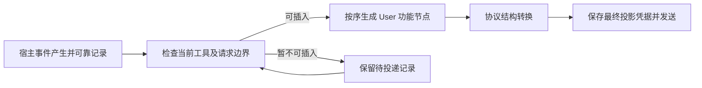

# 动态上下文与协议投影设计

> 对应[正式总计划](../../plan/20260920-04-AGENT_COMMUNICATION_AND_DYNAMIC_CONTEXT.md)。状态：实施中，验证证据见[工作报告](IMPLEMENTATION_LOG.md)。原始分析见[历史研究](../../plan/20260917-03-SUBAGENT_CROSS_SESSION_INTERACTION_RESEARCH.md)；协议事实不以当前 Vulcan 编码器的限制反推。

## 一、目标不变量

摘要实现补充（D297）：每次本地摘要尝试显式交接选定来源及模式。完整保真重放冻结的原生窗口；预算降级使用既有压缩器生成的精确最小输入及资源文字引用，不重新恢复业务历史或加载已省略媒体。服务核验来源、历史代次与精确物理位置，重试不能纳入上次失败摘要输出，输出归一化缓冲也随新尝试重置。最终摘要控制仍按 D296 追加请求局部 User 信封；普通业务角色、媒体和已发送历史不因此变化。接收器 33 项、运行时摘要 18 项通过；生产检查通过。证据范围及子代理未闭合边界见工作报告。

1. 面向整个上下文代次的稳定顶部提示维持原入口；所有非顶部宿主提示文本按实际发生时点投影为带功能标签的 User。
2. 更新表示为追加的新事件，不删除、改写或前置已发送的历史正文。
3. 真实用户、助手、工具调用/结果及媒体保留原生类型；User 统一策略只针对动态宿主提示文本。
4. 模式、授权、工具可用性和任务路由由宿主强制执行。User 标签不恢复 Developer/System 优先级。
5. 每条实际生产路由都使用相同的逻辑事件语义；不同协议只适配必要结构，不各自选择动态提示角色。
6. 保持旧前缀与保持 Provider continuation 是不同的判定；实际缓存命中必须使用真实计量，不能由静态代码保证。

## 二、中立上下文模型

在中立请求边界明确区分六类：顶部基线、流内宿主事件、真实用户、助手、原生工具、媒体内容。不能先把它们渲染成一段系统文本，再尝试从文本猜回来源。

宿主事件保留事件 ID、来源种类、源序号、所属任务/turn、有效范围、版本、正文或引用。事件身份在产生时确定，投影阶段只决定合法物理位置和编码，不每次制造新 ID。

投影记录关联逻辑事件与请求身份、物理消息/内容块位置、投影版本及上下文代次。该记录用于去重、恢复和检查顺序，不要求模型回显。

稳定顶部可包含固定的身份说明、信封解释及不随本轮事实变化的规则。历史中途的模式、记忆或其他事件即使原来标成 System/Developer，也不能因原 role 名称就被认定为稳定顶部；基线身份必须来自明确来源与代次。

## 三、全部生产者迁移清单

| 来源 | 当前需要解决的问题 | 目标表示与实施要求 |
| --- | --- | --- |
| `hidden_model_guidance` 与继续回合指引 | V1 TTL 状态可能从发生位置搬到历史前缀；旧提示文本还有另一表示。 | 一个逻辑事件，绑定本次 turn 的时点和有效期；核对两条表示最终是否重复。 |
| Goal 状态、目标版本、继续指引 | Developer 镜像可能在下游上提；另一目标提示路径改写当前用户文本。 | 强类型 Goal 状态不变，新增/修改/暂停/完成分别追加版本事件；原用户输入保持真实身份。 |
| Plan 模式 | 历史事件与请求级动态层可能同时携带内容。 | 选择一个权威事件来源，只投影一次；退出也追加失效或状态事件。 |
| VMM 基线画像 | 属于锁定基线，不能与刷新差量混淆。 | 在明确的基线建立/迁移/压缩边界冻结；普通刷新不改这一已发前缀。 |
| VMM 刷新差量与 Persistent 块 | 即使已是 User，仍可能位于全部历史之前。 | 刷新时产生事件，按发生位置追加；不重建请求前置快照。 |
| VMM 锚点与注入租约 | 请求局部副本可能改写已有 User 文本。 | 尚未发送内容允许在冻结前完成构造；已发送锚点的后续变化必须追加事件，不能回写旧正文。 |
| 临时注入 `transient_prefix` | 已有状态和重写判定，实际物理消费链仍待查清。 | 先找到所有生产/消费者；若确实缺失，补唯一事件投影，不直接猜为 System 前置。 |
| 工作区路径、执行模式等环境 | 请求级动态 User 位于历史前。 | 初始环境可在初始上下文边界记录一次；运行中变化按事件追加。 |
| 系统 Hook、动态工具说明、代码库路由 | 未标基线来源的动态 System/Developer 混在前层。 | 区分固定规则、目录变化及单次提示；文本事件走 User，真实工具 Schema 和执行权限保留独立机制。 |
| 压缩、提交摘要等专门请求用途 | 动态控制被通用前层渲染。 | 明确独立请求用途和自己的稳定基线；历史正文只是数据，不反向修改原业务上下文。 |
| 主子代理和跨会话消息 | 现有信封与普通输入、投递 ID、收件关系未统一。 | 使用类型化协作记录和新信封；任务/问答语义参照另外两份设计。 |
| 非 V1 与 ExcludedNonSession | Persistent、环境和 Plan 等可能整体渲染成第一条 System。 | 同一套分类与动态 User 编码；有历史的执行维护自己的事件顺序，单次执行明确一次性输入范围。 |

每类来源在 P05 都要记录“权威生产者 → 中立节点 → 实际路由输出”，包含内建、扩展 Hook 和非会话执行入口。不能只修普通 V1 而让同一内容在非 V1 再次取得顶部角色。

## 四、合法物理边界

“合法边界”是原生工具配对和具体协议约束允许插入文本的下一物理请求位置，不是整个业务任务的最终 Assistant。否则问题和方向引导都会被错误推迟到任务完成之后。

协作输入在持久层使用 `UserInputSource::AgentMessage`，协议层仍编码为 User。界面通过该来源类型避免重复的人类气泡，并用对应协作事件显示独立卡片；不得根据正文包含标签决定来源。消息投影与消费记录原子提交，引用真实输入 ID、序号和接收 turn。压缩请求不消费协作队列，只有后续实际业务或答疑请求接收这些内容。

若协议合并相邻 User，保留每个逻辑节点的起止边界和 ID，不依赖一条事件必须对应一条消息。工具结果仍使用真实调用 ID 与原生内容块，不能把宿主消息伪造成工具结果插入。

工具结果组、并行调用、服务端工具续轮、图片/音频/文件内容必须沿生产转换器核对。无法合法即时插入时记录待投递，不搬到顶部 System，也不擅自取消正在执行的调用。

## 五、生产协议覆盖

当前重点生产链为 V1 请求重建、Provider 请求编码、共享内部 Responses 表示、目标协议转换及传输。验收必须在最终编码边界读取真实输入，不能以独立 Profile 的输出替代共享生产链。

| 路由族 | 稳定顶部 | 动态宿主文本 | 必查结构 |
| --- | --- | --- | --- |
| Codex 原生 Responses | 保留既有顶部规则入口。 | 统一 User 信封，不以原生代理标签建立另一套问答权威。 | 原生输入类型、调用 ID、最终消息、continuation 与缓存作用域。 |
| 标准 Responses | 保留既有 instructions 等顶部入口。 | User 输入项，按事件顺序。 | 工具调用输出与历史重放；不得将动态 System 先抽掉再补猜位置。 |
| Chat Completions | 基线可使用原线路顶部方式。 | User 消息/内容，动态事件不进入 system 合并。 | tools、tool_call_id、相邻消息及多模态转换。 |
| Anthropic Messages | 保留原稳定 system。 | User 文本块。 | 相邻 User 合并、tool_result 次序及工具续轮的合法插入位置。 |
| Gemini GenerateContent、Code Assist、Interactions | 保留各线路的稳定顶部入口。 | User 内容节点。 | User/model 合并、functionCall/functionResponse 配对和媒体引用。 |
| 其他注册 Profile，包括 Cohere 等 | 按实际路由核实。 | 采用同一中立契约。 | 明确哪些在普通生产链可达、哪些仅为独立 Profile；不可达不等于上游不支持。 |

不新增逐供应商 Developer → System → User 的动态提示选路规则。上游支持哪些角色仍可记录为协议知识，但不影响本方案固定选择 User 的设计。

工具或媒体能力变化可能需要更新真实工具 Schema，这属于真实请求变化；不能为“缓存不变”保留已经失效的工具能力，也不能把这种变化与记忆前移混为同一缺陷。

## 六、有效期与压缩

普通 TTL 到期追加引用准确事件及版本的失效标记。原正文在当前历史中仍可见，模型通过后续状态识别其不再有效；不能宣称从模型或供应商缓存中物理删除。

有效期以定义的逻辑任务/turn 边界计算，不在同一 turn 的多次 API 请求中反复递减。到期事件按稳定身份只追加一次；应用重启或重新投影不能重复生成失效节点。

压缩是新的上下文代次：

1. 持久事件与问答权威记录保留审计和恢复能力。
2. 宿主依据权威状态构建当前有效上下文；失效提示不进入新的有效状态。
3. 摘要任务知道哪些原事件已失效，不能将失效指令写成当前要求；输出仍不能代替宿主状态。
4. 未结问题、待交付答案、当前角色和任务关联由类型化记录重建，不要求摘要复述 ID。
5. 在压缩边界一次性构造稳定快照及新基线；后续普通请求继续追加，不能每次重建快照头部。

对确需语义引用的历史内容，要标为历史事实而非当前指令。问答及授权的保留期限不能套用动态提示 TTL 自动清理。

### 压缩前沿与普通请求分离（2026-09-22）

每个已提交压缩节点的 `api_stats_seq` 是该上下文代次的固定指令筛选前沿，与该节点的 `retained_from_seq` 一同读取。宿主仅在此前沿排除已经失效或被后续更新替代的 SystemContext；既包括边界之前的回填，也包括保留尾段内部。筛选依据事件类型和原始 seq，不解析用户正文标签。原始事件仍完整落盘。

同代次后续普通请求复用此固定选择，前沿之后的更新与失效按原顺序追加。不能在每次请求时把回填推进到最新有效状态，否则后来的到期会删掉已经发送的前缀。新的压缩代次才可再次排除失效指令。

摘要规划使用当前已落盘前沿排除已经失效的指令；普通请求及 Continue 使用已提交压缩前沿。两者必须使用不同的明确投影用途，不能把摘要规划入口同时当作普通恢复入口。源 seq、用户资源参数、工具配对和协作事实保持原归属；筛选后的媒体索引仍由同一次投影遍历生成。

## 七、前缀与 continuation

检查三个不同事实：逻辑事件的生效顺序、最终编码内容是否改变既有前缀、供应商 continuation 是否仍满足复用条件。它们不能用一个“缓存有效”布尔值替代。

投影版本、基线版本、上下文代次和实际请求结构进入可审计的请求身份。若变更使旧请求历史字节或角色不再一致，应拒绝旧 continuation 并明确重建原因，不静默保留一个已经失配的游标。

离线验收以同一合成历史的相邻生产请求比较事件顺序和既有逻辑前缀；缓存命中率仅在获准真实请求并有供应商计量时报告。相邻 User 合并引起的物理容器变化必须单独解释，不能把 JSON 整体不相等直接等同于全部 token 缓存失效。

## 八、新契约与恢复边界

临时提示的按回合寿命仅由持久化 `TurnBoundaryEvent.purpose=business` 消费。`question_execution` 表示自然空闲辅助答疑，成功未回答或失败都不递减业务 TTL。该用途是必需字段，不通过旧数据缺省值推断。这样即使回放不包含起始事件，也不会仅因出现辅助闭合边界而提前使提示到期；原 turn 内顺带处理问题最终仍随该业务回合正常消费一次。

代理任务使用独立启动来源及业务用途，认领时已经追加规范 User 信封。准备从该历史恢复，不追加第二条提示，不新增按任务变化的顶部提示段；正文中的人类手动注入命令保持数据性质。模型装配继续使用目标原有主/子代理模式，工具能力及正常业务结束语义保留；该任务结束仍属于业务 TTL 边界，不能套用辅助答疑的免消费规则。

用户确认当前版本未发布，不考虑历史数据。全部新执行直接使用当前投影契约，版本按会话或明确上下文代次冻结；不实现旧投影双读、旧会话迁移或活动工具组混用。

当前契约的压缩和恢复仍记录上下文代次、有效模式、未结问题、基线和 continuation。已有请求与重建请求不一致时拒绝 continuation，不能为了复用而隐瞒前缀变化。

当前版本落盘或恢复失败时保留已提交事实并显式报错；不提供旧二进制降级或旧格式回滚。不手工删除用户已有历史数据。

## 九、源码落点与实施顺序

### 非 V1 事件与发生点身份（2026-09-22）

动态提示的 `occurrence_id` 标识具体发生点，更新事件与对应失效事件共同引用它；两者的 `event_id` 必须不同。原始事件 ID 保存在投影元数据中，`runtime-host:` 只用于规范消息 ID。精确重放同时比较来源、发生点、事件语义、内容哈希与实际信封字节；相同哈希不能掩盖正文或收件人变化。显式新发生点即使正文相同也保留，只有没有发生点身份的快照型生产者允许合并相同当前值。

同批候选先校验、后一次发布消息与元数据；后续候选冲突时不得留下前半批投影。只读取本生产者命名空间内的元数据，未知版本或缺失结构明确拒绝，不实现旧格式兼容。失效标记只追加，不删除或修改旧正文。

记录级压缩必须完整保留 `runtime-host-record:` 命名空间的来源、发生点和失效账本，包括原消息已离开活动窗口的记录。该元数据供宿主恢复、去重及冲突校验使用，不属于可清空的展示元数据。保留账本本身不会追加模型消息，也不能被当作“仍应发送旧正文”的依据；新的压缩上下文须另行依据有效状态筛选正文。消息及记录通过桥转换时，隐藏记录的展示角色可按既有规则规范化，身份与元数据必须不丢失。

#### 非 V1 压缩及归档重放契约（2026-09-22，D284—D288）

共同类型由 `vulcan-context::runtime_host` 持有，生产者和压缩器共用；必需字段 `envelope` 保存包含路由的强类型 `HostMessageEnvelope`，同一确定性编码器生成并核对精确信封正文；`compacted_out` 明确记录对应消息已离开活动上下文。无旧字段缺省或兼容路径。宿主记录 ID、事件 ID、来源内序号、发生点归属、信封事件种类、规范消息角色/正文/附件及归档标志必须一致；仍有效的指令必须存在原规范消息，不能从不明缺失中静默重建。

子代理压缩先在隔离克隆中排除失效及被替代的宿主消息，再从同一克隆规划尾段、发送本地或远端摘要。普通历史不改写。新的规范上下文回填仍有效但处于摘要范围中的精确宿主消息，并保留其原始顺序、身份和信封；用户正文中的相似标签以及原生助手和工具保持原身份。完整记录账本保留，排除的事件标为已移出消息窗口。

精确旧事件重放比较全部原信封和来源元数据；已归档的相同事件只确认，不再注入正文。新的发生点即使正文相同也追加。失效按发生点引用判定，旧失效晚到不覆盖新发生点；最新版本失效后不恢复更旧版本。后续普通请求只追加，新一次压缩才再次筛选。

#### 完整来源清单与局部辅助输入

物理 V1 压缩请求也必须使用当前有效指令视图，不能仅摘要规划使用该视图、实际请求却退回普通历史。初次准入捕获与媒体准备后的可靠重捕获共用本次 API 固定用途：压缩选择 `CompactionContext`，普通业务及答疑维持当前已提交代次的普通视图。此规则不改变资源完成和外部修订失配的原有准入检查。摘要专属输入的最终构造及不撤下业务动态清单仍需沿 Provider 接收器继续核验，不能把投影用途修复视为摘要全链完成。

V1 接收器现已将压缩用途从业务动态清单同步中分开。压缩的四类类型化动态层和最终摘要提示均在权威历史后构造请求局部 User 信封，来源为固定功能节点，身份绑定精确物理调用，作用域为 `compaction_request`。这些控制进入实际请求、控制器请求副本和预算历史，不写入业务事件或 metadata；既有顶部锁定提示保持不变，缺失最终摘要提示明确拒绝。正常业务继续走原完整清单同步。预算降级时使用的冻结来源/剪枝结果尚须贯穿最后物理重建，不能以局部控制隔离替代选段验收。

完整业务准备（用户业务、代理任务、业务重试）在成功组合动态提示和当前注入视图后，按整份清单对账。此前有效而当前缺席的来源追加撤下通知，引用原事件及发生点，沿原信封的来源、收件人、任务和作用域发送。消息和账本先在候选中完成全部校验，再整体发布；缺失清单不等于删除原始消息。重复清单不重复发送，过时清单不能重新激活已撤下的显式发生点。

临时答疑、上下文摘要及 Git 总结只持有局部准备，不能按缺席推断原业务来源已删除；这些请求只做增量同步。同一发生点只允许一个更新，独立撤下及迟到 TTL 可形成多个失效事件，各自按事件身份精确去重，均不得使旧指令复活。

bootstrap 与真实启动共用启动模式解析；只有正常 UserPrompt 的未发送末尾用户可作为前置插入边界。RestoredCheckpoint 和 ContinuedProviderTurn 中新增宿主消息一律追加，不能把历史末尾 User 当作新输入。宿主自身的 User 信封也不作为人类输入边界。

摘要预算降级或失败重试时，先按类型化账本从临时摘要副本排除宿主行，再剪枝普通对话；精确有效提示由最终正式改写回填，不交给截断后的信封承担。剪枝报告包含这些排除和真实输入估算。没有降级时保持完整摘要输入。有效提示的精确保留不意味着它不占新请求预算，新请求仍由正常准备计算完整上下文。

注入槽位更新正文时，必须同批保存已分配的新发生点和正文哈希，稳定来源 ID 不变；否则原事件冲突检查会正确拒绝被误标为旧事件的新正文。TTL 到期必须引用这一新版本。渲染器、元数据、来源标签变化也必须生成新发生点；组作用域/种类变化会改变全部成员路由，因此未直接重写的兄弟条目也要换版本。精确相同输入刷新保留原发生点，不把时间戳刷新当作正文更新。完整业务清单删除及这些固定输入变化已有实际生产链和状态测试；VMM 动态基线以及 V1 子代理压缩继续单独验收，不能据此宣布全部动态生产者完成。

VMM 待绑定基线的来源身份固定为当前纪元，发生点由纪元和准确正文哈希组成。同纪元内租约到期/撤销使基线缩减时追加新版本，旧版本保持原历史前缀，并在新压缩选择中排除。登记回合等未改变正文的状态修订不产生新消息。该规则适用于由当前活动租约生成的待绑定基线；已经追加的 VMM 锚点正文仍以其原不可变身份表示。新增真实状态、覆盖层、宿主同步及压缩回归已经通过，V1 子代理的持久化压缩入口继续独立核验。

bootstrap 的控制器顶部及预览播种使用与实际传输入口相同的稳定前导语构造层；完整装配层不能因为优先于前导语而重新把动态提示带入顶部。连续请求验证和实际生产编码证据分别记录在[验收证据索引](ACCEPTANCE_MATRIX.md)。

先修改类型化来源与生产者，再修改中立投影和生产出站，最后处理恢复与综合验收。优先路径包括：

- V1：`vulcan-session-core/src/v1/projection.rs`、`document/modes.rs`、`document/turns.rs`。
- 请求装配：`vulcan-service-kernel/src/agent_stream/provider_v1_sink.rs` 及 `provider_v1_sink/context_injection.rs`。
- 动态层：`vulcan-agent-runtime/src/agent_runtime/provider_runtime_context.rs`、`context_injection_runtime.rs`、`vmm_hooks.rs`、`execution_preparation.rs`。
- 生命周期：`vulcan-context-injection/src/context_injection/state.rs`、`vulcan-vmm/src/session_state.rs`。
- 非 V1：`vulcan-core/src/types.rs`、`vulcan-agent-runtime/src/agent_runtime/provider_transport_vulcan/request.rs`。
- 出站：`vulcan-provider-adapters/src/execution/request_encoding.rs`、`vulcan-ai-protocols/src/openai/internal_input.rs`、`vulcan-llm-core/src/internal_media.rs` 及各 `responses_to_*` 转换器。
- 压缩：`vulcan-context/src/protocol/projection.rs`、`vulcan-service-kernel/src/context_compaction/`；延续：`vulcan-agent-runtime/src/agent_runtime/provider_request_preview.rs`。

以上路径均相对仓库 `crates/`。具体模块与现行符号在实施起点复核；新代码仍须遵守仓库注释、资源同步、配置保护和测试并发约定。

## 原生压缩检查点的投影规则

已发布远端节点通过独立的检查点投影项进入快照。它替代被丢弃前缀，因此位于保留历史之前；固定顶部及保留历史中的用户、工具和宿主消息仍沿原规则处理。投影身份来自节点 ID，来源位置来自其成功压缩 API 的终态序号。不能从展示文字或任意转录元数据认定检查点身份。

检查点是原生协议上下文，不是新的提示词或助手结束回复。规范控制器以空正文的内部载体保存完整原生状态，不生成助手事件或聊天气泡，不把 compact 响应 ID 当延续游标。物理请求只投影有序原生项；供应商、连接、端点、协议和模型必须逐项匹配实际冻结执行，任何缺失或失配都明确拒绝，禁止用诊断正文代替或只发送剩余尾部。

再次压缩时，规划行保留稳定节点身份，再由同一类型化快照恢复不透明状态。冻结来源检查与主规划入口共用恢复函数，避免普通继续有检查点、下一次压缩却丢失它。最小模式通过共享 `NativeCompactionSources` 捕获规范来源：原生载体从普通剪枝输入中分离，保留完整原生项并按原时序合并，恢复时禁止遗漏、重复、重排和载体正文替换。宿主从类型化节点重建规范权威，再应用同一恢复规则；任意转录元数据不能获得原生来源权限。

剪枝预算预留序列化原生项的启发式开销；若不可剪裁内容本身过大，保持原文并报告仍超预算，不把它截断成无效检查点。最终物理请求继续走真实预算检查。最小模式即使不投影普通完整历史，也必须核对原生检查点与实际冻结路由及完整物理载荷一致。此规则不代表远端 HTTP 执行与主子完成器已经接通，验证范围以验收索引为准。
