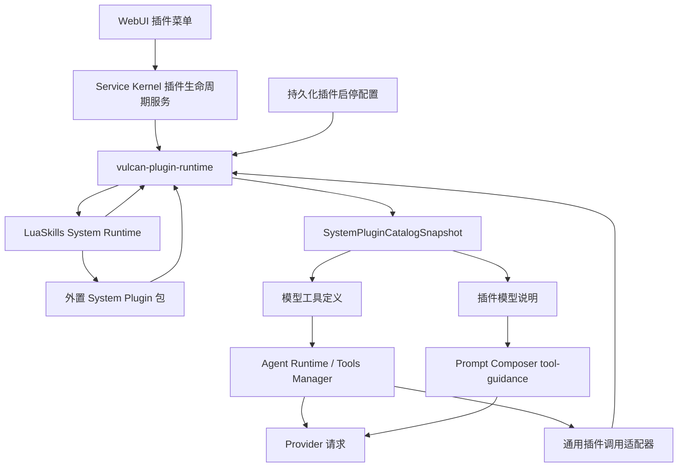

# VulcanCode 独立 System Plugin 宿主与外置插件包设计（2026-07-12）

## 1. 结论先行

本方案确认采用以下目标架构：

1. 新增独立通用 crate：`vulcan-plugin-runtime`。
2. `vulcan-plugin-runtime` 只实现插件发现、清单校验、生命周期、工具投影、模型说明投影、会话路由和宿主策略边界，不包含任何调试领域知识。
3. `vulcan-debug-runtime` 不再是 Rust crate，也不再由 `vulcan-agent-runtime` 硬编码；它改为一个完整、可独立校验和分发的插件包。
4. 插件包提供工具描述、输入 schema、模型操作说明、Lua 入口、Node sidecar、依赖清单和用户界面元数据。
5. 插件只有在“包可用、用户已启用、宿主校验通过、当前代理策略允许、当前请求允许工具”全部成立时，才向模型注册工具和说明。
6. 插件停用后，工具定义与模型说明必须在同一运行时快照中同时消失，禁止出现“工具已隐藏但说明仍在”或“说明已隐藏但工具仍可调用”的半状态。
7. 宿主继续拥有会话归属、工作区边界、包目录边界、并发配额、租约回收和能力授权；插件包不能自行扩大权限。

该方案不是“为调试插件单独再建一个 Rust crate”。独立 crate 是通用插件宿主；具体调试能力完全落在外置插件包中。这同时满足“插件机制有独立工程边界”和“具体插件脱离主 crate”的要求。

> 实现状态：本文所述第一版架构已在本轮落地。第 2 节保留的是实施前基线，用于解释迁移动机；后续章节以当前实现契约为准。

---

## 2. 设计依据与实施前事实

### 2.1 实施前工具注册存在跨层调试特判

实施前调试能力已经可以工作，但注册与管理仍然散落在宿主代码中：

- `vulcan-runtime-assets` 导出固定的调试插件 ID 常量。
- `AgentRuntimeConfig` 持有 `debug_runtime_enabled` 专用字段。
- `build_native_tool_catalog` 根据该字段调用 `build_debug_runtime_tools`。
- `skill_catalog_projection` 手工拼装 `vulcan-debug-runtime` 的插件卡片与资产列表。
- `service_set_luaskills_system_plugin_enabled` 只接受固定的调试插件 ID。
- WebUI 插件面板根据固定插件 ID 选择名称与能力文案。
- 浏览器回退工作台中还保留固定调试插件摘要。

因此，实施前实现本质上仍是“原生调试工具 + LuaSkills sidecar”，还不是可复用的插件机制。继续添加插件会复制同样的配置字段、注册分支、服务分支和 UI 特判。

### 2.2 当前模型说明链路已经具备可复用基础

当前 `VulcanToolDescriptor.help_text` 会进入 Prompt Composer 的 tool-guidance 层，并且只针对当前可见工具生成说明。LuaSkills 隐式调度也已有单独的开发者提示片段。

新插件协议不需要再造一套平行提示系统，但需要把现有能力提升为两个明确层级：

- 工具级说明：与某个工具一一对应，适合参数约束和局部调用规则。
- 插件级说明：描述一组工具的状态机、顺序约束、资源释放和协作方式，只渲染一次。

### 2.3 实施前调试包还不是完整插件包

当前包目录只包含：

- `dependencies.yaml`
- `runtime/plugin.lua`
- `node/sidecar.mjs`
- Node 包与锁文件
- sidecar 测试

五个模型工具的名称、描述、schema、超时、会话路由、所有权和并发策略仍在 `vulcan-agent-runtime/src/tooling/native/debug_runtime.rs` 中。目标迁移必须把领域定义移出该文件，而不是只把现有 Lua 文件换一个目录。

### 2.4 与既有 LuaSkills 分层保持一致

既有设计已经区分：

- `Core Runtime`：不可插件化的引擎、协议和宿主桥。
- `SystemSkills`：宿主固定依赖、不可普通启停的内部能力。
- `Bundled System Plugins`：官方随包发布、允许动态启停的能力包。
- `User / Project Plugins`：未来可安装的第三方能力包。

`vulcan-debug-runtime` 不属于不可关闭的 `SystemSkill`，应归类为 `Bundled System Plugin`。它默认启用、由宿主发布、可在 LuaSkills 控制界面的“插件”菜单中启停，但不进入普通 LuaSkill 安装/更新/卸载流程。

---

## 3. 目标分层



### 3.1 `vulcan-plugin-runtime` 的职责

该 crate 负责：

- 扫描固定插件根目录。
- 解析并校验 `plugin.yaml`。
- 校验包内相对路径，拒绝目录穿越和符号链接逃逸。
- 校验插件 ID、工具 ID、schema、运行入口和能力声明。
- 校验 `runtime.required_files` 声明的非 Schema 运行资产，缺失、重复、符号链接或越界路径均拒绝整包。
- 合并“清单默认状态”与用户显式启用、显式停用覆盖。
- 产出不可变、带修订号的 `SystemPluginCatalogSnapshot`。
- 将生效插件投影为工具定义和插件级模型说明。
- 管理通用插件会话、LuaSkills System Runtime 租约、所有权、并发和回收。
- 在启用、停用、资产变化和 LuaSkills reload 后重建快照。
- 为 Service Kernel 提供通用查询、启用、停用和诊断接口。

该 crate 不负责：

- CDP 或 DAP 协议语义。
- `Runtime.evaluate`、`Debugger.pause` 等调试命令知识。
- 调试插件专用 UI 文案。
- 某个固定插件 ID 的分支判断。
- 普通 LuaSkill 的安装、更新和卸载。

### 3.2 `vulcan-agent-runtime` 的职责

`vulcan-agent-runtime` 只消费通用快照：

- 将允许暴露的插件工具并入现有工具目录。
- 将生效插件说明并入 Prompt Composer 的 tool-guidance 层。
- 通过通用插件调用适配器执行工具。
- 在一次执行准备中固定工具与说明的同一修订快照。

迁移完成后，`vulcan-agent-runtime` 中不应再出现：

- `debug_runtime_enabled`
- `build_debug_runtime_tools`
- `DEBUG_SESSION_*_TOOL_ID`
- `VULCAN_DEBUG_RUNTIME_SYSTEM_PLUGIN_ID`
- 调试插件包路径或资产文件名

### 3.3 Service Kernel 与 WebUI 的职责

Service Kernel 只处理通用插件生命周期：

- `list_system_plugins`
- `set_system_plugin_enabled(plugin_id, enabled)`
- `refresh_system_plugins`
- `system_plugin_diagnostics(plugin_id)`

WebUI 根据服务端投影渲染插件卡片，不再根据 `plugin.id === "vulcan-debug-runtime"` 选择名称和能力文案。

---

## 4. 外置插件包目录

### 4.1 源码与运行时位置

插件源码已从 crate 内部资源目录迁移到仓库顶层：

```text
plugins/
  system/
    vulcan-debug-runtime/
      plugin.yaml
      dependencies.yaml
      model/
        instructions.md
      schemas/
        debug_session_open.json
        debug_session_request.json
        debug_session_events.json
        debug_session_status.json
        debug_session_close.json
      locales/
        en.yaml
        zh-CN.yaml
      runtime/
        plugin.lua
      node/
        sidecar.mjs
        sidecar.test.mjs
        package.json
        pnpm-lock.yaml
```

构建和启动初始化阶段将该目录原样同步到：

```text
<lua_runtime>/system_lua_lib/vulcan-debug-runtime/
```

构建脚本在 `system_lua_lib/.vulcan-code-managed-plugins` 中记录自己部署的包名，只清理该索引中已由源码移除的陈旧包；LuaSkills 或其他宿主拥有的未知同级目录不会被删除。这样保留 LuaSkills 当前 System Runtime 的目录契约，同时让具体插件源码不再属于任何业务 crate。`vulcan-runtime-assets` 不再导出具体插件 ID 常量。

### 4.2 为什么不把具体插件做成 Rust crate

如果每个插件都成为 Rust crate：

- 新增插件仍需修改 workspace 和重新编译主程序。
- 工具定义和插件生命周期仍会与宿主发布绑定。
- Lua/Node 插件包只会退化成 Rust 包的资源附件。
- 无法验证“禁用后不注册”“按包发现”“按包升级”的真实插件语义。

因此，只有通用宿主协议做成 crate；具体插件是数据与脚本包。

---

## 5. `plugin.yaml` 协议

### 5.1 第一版示例

```yaml
schema_version: 1
id: example-system-plugin
version: 0.1.0
kind: bundled_system
default_enabled: true
display:
  name: Example System Plugin
  capability: Example managed tools and Lua hooks
platforms:
  excluded_targets:
    - aarch64-pc-windows-msvc
runtime:
  dependencies_file: dependencies.yaml
  module: runtime.plugin
  invoke_function: dispatch
  shutdown_function: shutdown
  hook_shutdown_function: shutdown_hooks
  max_active_sessions: 8
  session_idle_timeout_sec: 1800
tools:
  - id: example_session_open
    group: example_tools
    description: Open one owned example session.
    parameters_file: schemas/example_session_open.json
    available_in_plan: false
    execution:
      kind: session_open
      operation: open
      timeout_ms: 30000
  - id: example_session_request
    group: example_tools
    description: Send one request through an owned example session.
    parameters_file: schemas/example_session_request.json
    execution:
      kind: session_call
      operation: request
      timeout_ms: 30000
      timeout_argument: timeout_ms
      max_timeout_ms: 60000
      timeout_grace_ms: 5000
  - id: example_session_close
    group: example_tools
    description: Close one owned example session.
    parameters_file: schemas/example_session_close.json
    execution:
      kind: session_close
      operation: close
      timeout_ms: 5000
hooks:
  - id: turn-precheck
    point: conversation.turn.precheck
    mode: transform
    scope: global
    function: on_turn_precheck
    priority: 100
    timeout_ms: 30000
    failure_policy: continue
    requested_capabilities:
      - config_read
    display_name: Example precheck
    progress_label: Checking example plugin state
prompt_contributions:
  - id: example-workflow
    file: model/instructions.md
    required_tools:
      - example_session_open
      - example_session_request
      - example_session_close
locales:
  en: locales/en.yaml
  zh-CN: locales/zh-CN.yaml
```

### 5.2 清单字段原则

- 所有面向模型的 `description`、schema 字段说明和 `model/instructions.md` 固定使用英文。
- 面向用户的名称、能力摘要和状态说明放入 `locales/`。
- 清单只能引用包内相对路径。
- 工具 ID 在全局模型工具命名空间中必须唯一。
- `default_enabled` 只定义首次默认值；用户显式状态由宿主持久化，插件包不能覆盖。
- 平台矩阵沿用 VulcanCode 当前正式发布目标，唯一明确排除 Windows ARM（`aarch64-pc-windows-msvc`）；不允许因插件迁移缩减其他已支持系统。
- `capabilities` 是请求，不是授权；宿主只接受自身支持且允许的能力组合。
- 第一版只接受 `kind: bundled_system`，不将未受信任用户包直接提升为 System Runtime 插件。

### 5.3 工具组必须支持原子暴露

调试工具是一个状态机集合。若只暴露 `open` 而隐藏 `close`，或者只暴露 `request` 而隐藏 `events`，模型会得到不可安全使用的表面。

因此第一版把每个工具的 `group` 作为原子组标识，并要求一个插件最多声明一个非空工具组：

- 组内全部工具同时通过代理策略和请求策略时，整组注册。
- 任意一个工具被过滤时，整组不注册，并产生可诊断警告。
- 插件级模型说明只在整组实际可见时注入。

该规则避免插件启用状态、代理工具策略和说明注入之间形成残缺组合。

---

## 6. 插件运行协议

### 6.1 统一 Lua 入口

插件包只需实现统一入口：

```lua
function M.dispatch(args)
    -- args.payload_json 由宿主编码。
    -- 返回完整结果信封的 JSON 字符串。
end

function M.shutdown(args)
    -- 关闭当前租约中的持久进程和协议连接。
    -- 返回完整结果信封的 JSON 字符串。
end
```

宿主负责把完整调用编码为 JSON 字符串，Lua 和 Node 不再进行会把空对象变成数组的 table 往返。该要求延续已经通过真实 CDP 测试的修复方式。

### 6.2 通用请求信封

宿主传给插件的请求至少包含：

```json
{
  "op": "request",
  "method": "Runtime.evaluate",
  "params": {},
  "request_id": "42",
  "host_timeout_ms": 30000
}
```

其中：

- `op`、`request_id` 和 `host_timeout_ms` 由宿主生成。
- 模型参数保留在同一对象中，但不能覆盖宿主持有的 `op`。
- `session_id` 由宿主从模型参数中提取并校验，不能由插件自行声明归属。
- 插件不能通过返回值修改宿主上下文或权限。

### 6.3 通用结果信封

```json
{
  "ok": true,
  "result": {}
}
```

失败结果：

```json
{
  "ok": false,
  "error": "..."
}
```

插件必须返回精确 JSON 文本；宿主解码 `result` 并负责工具层格式化。结构化 `error` 也允许保留，宿主会在不丢失字段的前提下渲染诊断。

### 6.4 会话模式

通用宿主支持四种执行模式：

- `stateless`：单次创建租约、调用、关闭。
- `session_open`：创建宿主持有的插件会话与 System Runtime 租约。
- `session_call`：按 `session_id` 路由到既有租约。
- `session_close`：调用关闭入口并回收租约。

宿主维护的会话记录至少包含：

- `session_id`
- `plugin_id`
- `plugin_generation`
- `owner_session_id`
- `lease_id`
- `sid`
- `lease_generation`
- `last_activity_unix_ms`
- `closing`

插件只看到当前调用所需的宿主上下文，不直接访问会话注册表。

每次 LuaSkills System Lease eval 与 close 都必须回传创建阶段确认的 `lease_id + sid + generation`。eval 请求还必须携带宿主计算后的 `timeout_ms`，由 LuaSkills VM 超时守卫约束 Lua 本身，而不是只把超时值作为普通参数交给插件自行遵守。

### 6.5 声明式 Lua Hook

System Plugin 可以在 `plugin.yaml` 的 `hooks` 列表中声明：

- 插件内稳定 `id`
- 已由宿主注册的精确 `point`
- `observe`、`transform`、`decision` 或 `effect` 模式
- Lua 模块 `function`
- `scope`、`priority`、`timeout_ms` 与 `failure_policy`
- `requested_capabilities`
- 可选显示名称与阻塞式前置进度文案

宿主不会建立第二套 Hook 总线。插件声明必须转为现有 `vulcan-hooks::HookRegistration`，继续复用现有点位描述、模式校验、优先级排序、超时、失败策略和结果聚合。

每个启用插件拥有一份按插件 generation 绑定的持久 Hook Lua 租约。同一插件的 Hook 串行进入该租约，以保留确定性的插件本地状态。Lua 函数从 `args.invocation_json` 接收宿主精确序列化的 `registration`、`context` 与当前 `payload`，返回统一 JSON 信封；其中 `result` 必须可解码为既有 `HookResult`。因此 payload 替换、decision、context injection、system prompt block 和 diagnostics 均由现有宿主调度器继续处理。Hook 清单超时同时进入既有 HookDispatcher 与 LuaSkills eval 超时守卫。

启用状态发生变化时，宿主必须按以下顺序处理：

1. 先发布新的插件 generation 与 Hook 快照。
2. 原子同步现有 `HookDispatcher` 注册项。
3. draining 后拒绝旧 generation 的新调用。
4. 等待插件 Hook 串行门内的当前调用结束。
5. 调用可选 `hook_shutdown_function`。
6. 关闭 System Runtime 租约并保留清理诊断。

插件请求能力不等于宿主自动授权能力。Hook 只能看到 `HookContext.capabilities` 已明确授予的集合；System Plugin 清单不得绕过现有能力边界。

---

## 7. 模型工具与说明注册

### 7.1 单一生效条件

一个插件工具进入模型请求必须同时满足：

```text
包已发现
AND 清单校验通过
AND 依赖可用
AND 用户已启用
AND 插件初始化成功
AND 当前代理策略允许完整工具组
AND 当前请求允许工具调用
```

任何条件不成立时：

- 不注册函数工具。
- 不注入插件级模型说明。
- 不保留可通过旧工具 ID 绕过的调用入口。

### 7.2 工具描述与插件说明分工

工具 `description` 保持短而具体，直接进入 Provider 的函数工具定义。

`model/instructions.md` 描述跨工具行为，例如：

- 先 `debug_session_open`，后续只使用返回的 `session_id`。
- 调用 `Debugger.pause` 后必须等待 `Debugger.paused` 事件，再执行调用帧求值、单步或恢复。
- `Debugger.resume` 只能在已暂停状态使用。
- 调试结束始终调用 `debug_session_close`。
- `--inspect-brk` 与 `--inspect` 的初始状态差异。

这类说明不应复制到五个工具的 description 中，也不应无条件进入全局 system prompt。

### 7.3 新的提示词投影类型

插件宿主层当前定义：

```rust
pub struct SystemPluginPromptContribution {
    pub plugin_id: String,
    pub id: String,
    pub body: String,
    pub required_tools: Vec<String>,
}
```

执行准备阶段在完成代理策略和请求级工具过滤后，再选择 contribution。只有 `required_tools` 全部存在于最终可见工具集合时，正文才按目录稳定顺序追加到开发者提示片段。

不能把插件级说明塞进任意一个工具的 `help_text` 作为临时方案，因为该工具被单独过滤、重命名或迁移后会造成说明意外消失。`help_text` 仍保留给真正的工具级说明。

### 7.4 同一修订快照

一次执行准备必须从同一个 `SystemPluginCatalogSnapshot.revision` 取得：

- 工具定义
- 工具 handler
- 插件说明
- 插件状态
- 包根目录与运行时入口

Provider 请求开始后不再动态替换本轮快照。启停或刷新影响下一次执行准备；正在运行的调用由生命周期管理器按停用规则收口。

### 7.5 工具来源与策略必须成为独立维度

当前统一工具描述只区分 `Native`、`LuaSkills`、`Mcp` 和 `AiFallback`。若插件工具继续伪装为 `Native`，插件启停虽然表面可用，但策略、诊断和 UI 仍无法区分“宿主编译内建工具”与“外置插件工具”。

当前实现如下：

- 为 `VulcanToolSourceKind` 增加 `SystemPlugin`。
- `RuntimeFoundation` 单独保存插件工具定义、工具组和 prompt contribution，不混入 `NativeToolCatalog` 的真相源。
- 代理定义与工具策略增加 `plugin_tools` 和 `allow_all_plugin_tools`。
- 请求级 tool exposure 对 `SystemPlugin` 来源执行全局 selector 过滤，并在过滤后保持插件原子工具组完整。
- Tools Manager 通过通用 candidate adapter 合并插件工具，而不是把插件 handler 包装成原生工具后失去来源。

兼容语义：

- 未声明专用工具策略的普通代理，默认获得当前已启用且完整可见的 System Plugin 工具组，与当前“默认获得全部可用原生工具”的体验一致。
- 显式受限代理只获得其 `plugin_tools` 或策略允许的工具组。
- 旧配置若曾把调试工具 ID 写入 `native_tools`，配置迁移必须将这些已知 ID 移入 `plugin_tools`；迁移完成后不保留双路径匹配。
- 原子工具组在策略解析完成后统一判定，不能在每个工具独立注册后再尝试补救。

---

## 8. 生命周期与刷新

### 8.1 启用

启用顺序：

1. 获取全局插件生命周期写锁。
2. 重新发现并校验目标包。
3. 校验依赖和宿主能力授权。
4. 执行最小初始化探测，不创建真实业务会话。
5. 持久化启用状态。
6. 构建新 `SystemPluginCatalogSnapshot`。
7. 刷新 `RuntimeFoundation`。
8. 发布带修订号的插件目录与 WebUI 状态。

若第 2 至第 4 步失败，不改变持久化状态。若持久化失败，回滚本次初始化。

### 8.2 停用

停用顺序：

1. 获取全局插件生命周期写锁。
2. 将插件运行态标记为 `draining`，拒绝新的 `session_open` 和普通调用。
3. 持久化停用状态。
4. 立即发布不含该插件工具与说明的新快照。
5. 对既有插件会话执行有界关闭和租约回收。
6. 发布最终 `disabled` 或 `disabled_with_cleanup_warning` 状态。

清理失败不能让工具重新暴露，但必须留下明确诊断。禁止静默遗留 sidecar。

### 8.3 运行中快照语义

- 已经进入插件 handler 的单次调用允许在有界超时内结束。
- 停用后不接受新的调用，即使旧 Provider 请求还持有旧工具定义。
- 旧请求调用时，handler 必须通过共享生命周期管理器再次检查插件 generation，而不是只相信旧目录快照。
- 现存会话由停用流程统一关闭；下一轮模型请求不会再看到 `close` 工具，因此不能把清理责任留给模型。

### 8.4 LuaSkills reload 联动

LuaSkills bootstrap、catalog reload、管理操作完成后，除现有 LuaSkills 工具表刷新外，还必须：

1. 重新校验 System Plugin 包与受管依赖。
2. 重建插件目录快照。
3. 刷新 `RuntimeFoundation`。

这三步必须位于同一个有序刷新流程中，避免“LuaSkills 已更新但插件工具仍是旧快照”。

---

## 9. 安全与信任边界

### 9.1 第一版信任模型

第一版仅支持随 VulcanCode 发布的 `bundled_system` 插件。包来源是构建产物，运行时目录由宿主初始化脚本维护。

第一版明确不支持：

- 用户把任意目录声明为 System Plugin。
- 远程下载后未经签名或校验直接启用。
- 插件自行请求任意 Node/Python 可执行文件。
- 插件通过清单声明获得任意网络或文件系统权限。

未来开放第三方插件前，必须另行完成签名、来源证明、能力授权 UI、进程隔离和更新回滚设计。

### 9.2 宿主强制边界

通用宿主必须强制：

- 插件包根目录固定且经过 canonicalize。
- 清单引用文件必须位于包根目录内且为普通文件。
- 运行时只能使用宿主管理的 LuaSkills、Node 和 Python 依赖。
- 进程启动只能走 LuaSkills managed runtime API。
- 插件会话只能由创建它的会话使用。
- 插件级和全局并发配额由宿主控制。
- 所有调用有最大请求大小、最大响应大小和最大超时。
- 停用、应用退出和会话归档均触发租约回收。

### 9.3 能力声明不是自行授权

第一版只加载仓库随包发布的 `bundled_system` 包，不提供第三方插件授权模型，也不在 `plugin.yaml` 顶层开放通用能力扩权字段。Hook 的 `requested_capabilities` 只能申请现有 Hook 点允许的能力，最终仍由 `vulcan-hooks` 校验；声明本身不会扩权。

调试插件的回环地址限制当前由受信任的随包 Node sidecar 强制校验，并由真实协议测试覆盖。LuaSkills System Runtime 负责包根、工作区根、依赖与受管进程边界，但第一版不把该组合宣称为第三方代码的完整网络沙箱。

---

## 10. 领域模型与 crate API 概念映射

### 10.1 核心只读模型

```rust
pub struct SystemPluginCatalogSnapshot {
    pub root: PathBuf,
    pub revision: u64,
    pub plugins: BTreeMap<String, SystemPluginDescriptor>,
    pub enabled_tools: BTreeMap<String, SystemPluginToolDescriptor>,
    pub enabled_hooks: BTreeMap<String, SystemPluginHookDescriptor>,
    pub prompt_contributions: Vec<SystemPluginPromptContribution>,
    pub diagnostics: Vec<String>,
}

pub struct SystemPluginDescriptor {
    pub id: String,
    pub version: Option<String>,
    pub package_root: PathBuf,
    pub content_fingerprint: u64,
    pub availability: SystemPluginAvailability,
    pub desired_enabled: bool,
    pub runtime_state: SystemPluginRuntimeState,
    pub generation: u64,
    pub active_session_count: usize,
    pub tools: Vec<SystemPluginToolDescriptor>,
    pub hooks: Vec<SystemPluginHookDescriptor>,
    pub prompt_contributions: Vec<SystemPluginPromptContribution>,
    pub diagnostics: Vec<String>,
}

pub struct SystemPluginToolDescriptor {
    pub plugin_id: String,
    pub plugin_generation: u64,
    pub id: String,
    pub group: String,
    pub description: String,
    pub parameters_schema: serde_json::Value,
    pub available_in_plan: bool,
    pub manifest: SystemPluginToolManifest,
}
```

这些类型当前全部位于不依赖 `vulcan-agent-runtime` 的 `vulcan-plugin-runtime` 中，工具描述使用插件宿主自有 DTO，未形成反向依赖。

### 10.2 可变运行时管理器

```rust
pub struct SystemPluginRuntimeManager { /* private shared state */ }

impl SystemPluginRuntimeManager {
    pub fn snapshot(&self) -> Arc<SystemPluginCatalogSnapshot>;
    pub fn refresh_catalog(&self, disabled: &BTreeSet<String>, enabled: &BTreeSet<String>)
        -> Result<Arc<SystemPluginCatalogSnapshot>, SystemPluginRuntimeError>;
    pub fn begin_enabling(&self, plugin_id: &str) -> Result<(), SystemPluginRuntimeError>;
    pub fn begin_draining(&self, plugin_id: &str) -> Result<(), SystemPluginRuntimeError>;
    pub async fn drain_plugin_sessions(&self, plugin_id: &str)
        -> Result<SystemPluginDrainReport, SystemPluginRuntimeError>;
    pub async fn invoke(&self, request: SystemPluginInvocationRequest)
        -> Result<serde_json::Value, SystemPluginRuntimeError>;
    pub async fn invoke_hook(&self, hook: &SystemPluginHookDescriptor, invocation: HookInvocation)
        -> Result<HookResult, SystemPluginRuntimeError>;
}
```

`AgentRuntime`、Service Kernel 和 WebUI 投影都只面向该通用管理器与只读快照，不持有调试插件实现类型；启停配置持久化事务由 Service Kernel 负责。

### 10.3 依赖方向

实际依赖方向：

```text
vulcan-plugin-runtime
  -> vulcan-hooks
  -> LuaSkills runtime adapter

vulcan-agent-runtime
  -> vulcan-plugin-runtime

vulcan-service-runtime / vulcan-service-kernel
  -> vulcan-plugin-runtime

vulcan-runtime-assets
  -> 不依赖任何具体插件实现
```

不允许 `vulcan-plugin-runtime -> vulcan-agent-runtime`，否则独立边界失效。

---

## 11. 服务与 WebUI 投影

### 11.1 `PluginSummary` 应由清单生成

当前服务端投影包含：

- `id`
- `version`
- `kind`
- `desiredEnabled`
- `runtimeState`
- `available`
- `nameByLocale`
- `capabilityByLocale`
- `toolCount`
- `tools`
- `hookCount`
- `activeSessionCount`
- `diagnostics`
- `managementKind`

`managementKind` 对该类插件统一为 `systemPlugin`，但服务动作必须接受目录中真实存在且种类允许管理的插件 ID，而不是固定白名单单个 ID。

### 11.2 UI 行为

- 插件菜单只显示 `SystemPluginCatalogSnapshot` 中的插件。
- 开关操作期间显示 `enabling`、`draining` 等真实生命周期状态。
- 资产缺失或清单错误时显示不可用和诊断，不允许点击启用。
- UI 名称和能力摘要来自插件本地化资源，不再写插件 ID 特判。
- 普通 LuaSkill 与 System Plugin 保持不同管理动作，禁止把 System Plugin 发送给普通 skill manager。

---

## 12. 调试插件模型说明

`model/instructions.md` 当前已经覆盖已通过测试的正确状态机：

1. 使用 `debug_session_open` 建立 CDP 或 DAP 会话。
2. 保存并只使用宿主返回的 `session_id`。
3. CDP 下先启用所需域，再发送运行控制命令。
4. `Debugger.pause` 返回成功只表示暂停请求已接受；必须轮询 `debug_session_events` 并观察 `Debugger.paused` 后，才能调用：
   - `Debugger.evaluateOnCallFrame`
   - `Debugger.stepOver`
   - `Debugger.stepInto`
   - `Debugger.resume`
5. 单步命令后再次等待新的 `Debugger.paused` 事件。
6. 已恢复状态下再次调用 `Debugger.resume` 返回 “Can only perform operation while paused” 属于符合协议的预期失败。
7. 无论成功或失败，结束时调用 `debug_session_close`。

说明中不得把测试环境专用路径、端口或进程 ID 写成固定值。

---

## 13. 迁移阶段

### 第一阶段：建立通用协议与只读目录

- 新建 `vulcan-plugin-runtime`。
- 定义并校验 `plugin.yaml`。
- 扫描顶层 `plugins/system` 构建只读目录。
- 增加重复工具 ID、路径逃逸、未知能力和 schema 错误测试。
- 暂不切换真实调试工具执行。

### 第二阶段：外置调试插件定义

- 将调试插件源码移至 `plugins/system/vulcan-debug-runtime`。
- 增加清单、五个工具 schema、模型说明和本地化资源。
- 通用资源同步逻辑将插件包复制到 `system_lua_lib`。
- 对比新目录生成的工具定义与旧硬编码工具定义，要求 ID、schema 和模型可见性一致。

### 第三阶段：通用会话执行适配器

- 在 `vulcan-plugin-runtime` 实现 session open/call/close。
- 把当前 Rust 调试 manager 中的通用所有权、并发、租约和关闭逻辑迁入该适配器。
- 把 CDP/DAP 领域校验、sidecar 调度和协议状态留在插件包。
- 复用现有真实 Node + LuaSkills smoke test。

### 第四阶段：切换模型注册与说明

- `RuntimeFoundation` 接收插件目录快照。
- 工具暴露解析加入原子工具组。
- 执行准备链路接入 `SystemPluginPromptContribution`。
- 插件启用时注册五个工具与说明；停用时两者同时消失。
- 对旧请求持有旧快照但插件已停用的场景增加 generation 拒绝测试。

### 第五阶段：切换服务与 UI

- Service Kernel 改为通用插件生命周期接口。
- WebUI 删除调试插件 ID 特判。
- 插件状态、名称、能力和诊断全部来自目录投影。
- 保留现有“插件”菜单节点和开关体验。

### 第六阶段：删除旧实现

- 删除 `tooling/native/debug_runtime.rs`。
- 删除 `debug_runtime_enabled`。
- 删除具体插件常量和硬编码资产列表。
- 删除固定插件 ID 的 service 分支与 UI 分支。
- 增加架构边界测试，禁止上述调试符号重新进入主 crate。

---

## 14. 测试矩阵

### 14.1 清单与目录测试

- 合法包成功发现。
- 缺少清单、schema、入口或依赖文件时标记不可用。
- 相对路径逃逸、绝对路径、符号链接逃逸被拒绝。
- 重复插件 ID、重复工具 ID、重复 contribution ID 被拒绝。
- 未知 `schema_version` 和未知能力被拒绝。
- 非对象形工具输入 schema 被拒绝或按明确协议处理。

### 14.2 注册与提示测试

- 插件启用且完整可见：五个工具和一份插件说明同时出现。
- 插件停用：五个工具和插件说明全部不存在。
- 包不可用：不注册工具和说明，并产生诊断。
- 原子组任一工具被策略过滤：整组与说明均不注册。
- 内部压缩、标题生成等禁用工具的请求：不注入插件说明。
- 多次刷新不重复注入说明。
- 工具 description 不被再次复制到 tool-guidance。

### 14.3 生命周期测试

- 启用成功后下一轮执行立即可见。
- 停用后下一轮执行立即不可见。
- 旧 Provider 请求在停用后发起工具调用会被 generation 检查拒绝。
- 停用会关闭全部 sidecar 和 System Runtime 租约。
- 会话归档、应用退出和超时会回收租约。
- 非所有者会话不能使用或关闭另一个会话的 `session_id`。
- 超过并发上限时返回稳定错误，不创建额外进程。

### 14.4 调试协议回归测试

在调试协议回归之前，声明式 Lua Hook 需要单独覆盖：

- 启用插件的声明可注册到已知宿主点位，未知点位或不兼容模式被拒绝。
- Lua 返回的 payload、decision 与 diagnostics 由现有 dispatcher 正确聚合。
- 同一插件连续 Hook 调用复用持久 Lua 状态。
- 插件进入 enabling、draining、disabled 或 generation 变化后，旧 Hook 不再进入 Lua。
- 停用与宿主退出会释放 Hook 租约；shutdown 失败保留诊断但仍尝试关闭租约。
- 多次同步不产生重复注册，失败同步不会破坏既有 dispatcher。

至少保留两轮真实 Node 调试测试：

- `node --inspect-brk`
- `node --inspect`

每轮覆盖：

- 打开与关闭
- `Debugger.enable {}`
- `Runtime.evaluate`
- `Debugger.pause` 后等待 paused 事件
- `Debugger.evaluateOnCallFrame`
- `Debugger.stepOver` 后等待 paused 事件
- `Debugger.stepInto` 后等待 paused 事件
- `Debugger.resume` 后等待 resumed 事件
- 非暂停状态下重复 resume 的预期失败
- 0 次 CBOR / 空对象退化错误

### 14.5 架构边界测试

- `vulcan-agent-runtime` 不得出现调试插件 ID、工具 ID或包路径。
- `vulcan-service-kernel` 不得硬编码具体 System Plugin ID。
- WebUI 不得根据具体插件 ID选择名称或能力文案。
- `vulcan-runtime-assets` 不得导出具体插件常量。
- 新增第二个最小测试插件时，无需修改 Agent Runtime、Service Kernel 或 WebUI 业务分支。

### 14.6 平台测试

- 插件发现、清单解析、Lua 入口和 managed Node sidecar 测试覆盖 VulcanCode 当前正式发布平台。
- 唯一明确排除的目标是 Windows ARM（`aarch64-pc-windows-msvc`）。
- 路径拼接、进程关闭、换行、信号与端口解析不得只按 Windows x64 实现。
- CI 无法运行真实调试器的平台至少执行包校验、schema、生命周期和 sidecar 协议单测；正式支持平台在发布前执行真实 CDP smoke test。

---

## 15. 验收标准

设计落地后必须满足：

1. 调试插件由包清单完整声明五个模型工具和模型说明。
2. 主 Rust 业务 crate 中不存在调试插件专用注册逻辑。
3. 插件启停同时控制工具、说明、执行入口和 UI 状态。
4. 工具与说明来自同一带修订号快照。
5. 插件停用后旧请求不能继续打开或调用会话。
6. 所有插件会话都有宿主所有权、并发限制和确定性回收。
7. 真实 CDP 两轮状态机测试继续通过。
8. 添加第二个随包 System Plugin 只需增加插件包，不需添加主流程特判。
9. 普通 LuaSkill 管理与 System Plugin 管理保持隔离。
10. 全工作区检查、格式化、Clippy、前端类型检查和插件协议测试全部通过。

---

## 16. 明确非目标

本轮架构不直接承诺：

- 第三方未受信任插件市场。
- 用户插件签名与远程更新。
- 完整 OS 级沙箱。
- 任意 Rust 动态库插件。
- 把 `ask`、子代理、Shell 等所有原生工具立即迁移为插件。
- 改变 LuaSkills 普通 skill 的安装与注册协议。

先用调试插件验证“包发现、启停、工具、说明、会话和回收”的完整闭环，再评估其他能力是否适合迁移。

---

## 17. 已确认决策与实施前剩余约束

### 17.1 已确认

- 使用独立通用插件宿主 crate。
- 具体调试插件完全外置为插件包。
- 插件启用时才注册工具与模型说明。
- 插件停用时不注册工具与模型说明。
- 插件通过 LuaSkills System Runtime 使用受管 Node/Python 能力。
- 调试插件属于可动态启停的 `Bundled System Plugin`。
- System Plugin 可声明现有宿主点位上的 Lua Hook，但不建立第二套 Hook 总线。
- 支持 Windows、Linux 与 macOS 的宿主管理运行时；明确排除 Windows ARM 目标。

### 17.2 实施时必须守住的约束

- 不允许为了兼容旧硬编码链路长期保留两套真相源。
- 影子对比阶段结束后必须删除旧调试注册实现。
- 不允许把包级说明临时绑在某一个工具的 `help_text` 上。
- 不允许让插件包自行决定会话所有权、租约 ID或宿主权限。
- 不允许在 LuaSkills 运行时缺少强制安全边界时，把随包可信模型宣传成第三方安全沙箱。
- 不允许启停操作只更新 UI 或配置而不刷新 Runtime Foundation。
